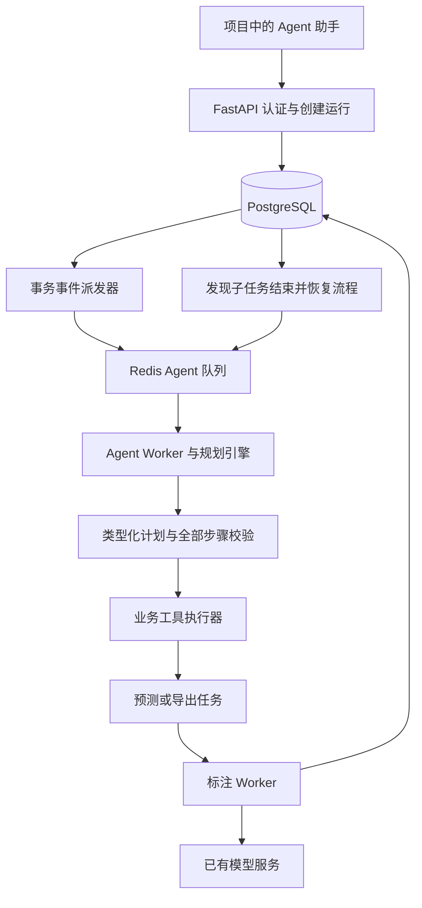
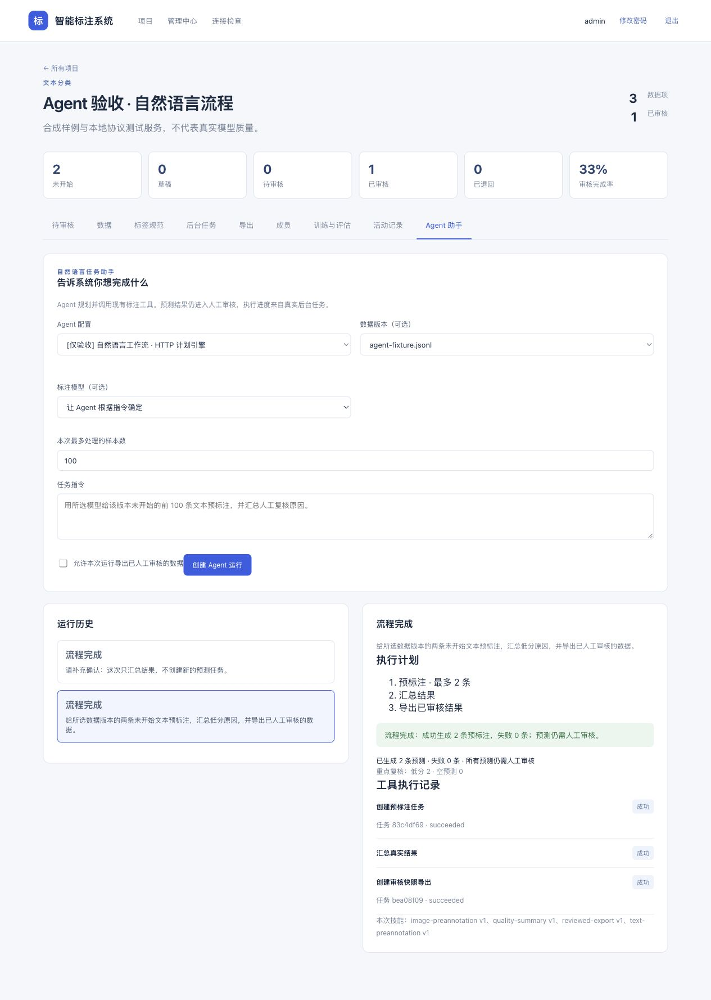

# Agent 实现与使用说明

更新日期：2026-11-06。

## 1. 实现结果

已增加 Claude Agent SDK 接入、类型化计划、受限业务工具、技能编辑、运行历史、补充信息、任务取消和等待后的恢复。当前安装并锁定 `claude-agent-sdk 0.2.178`，随包 CLI 的本机版本检查为 `2.1.318`。

采用官方 SDK，不复制或修改 Claude Code 产品实现。SDK 与依赖的使用条款见 [官方 SDK 仓库](https://github.com/anthropics/claude-agent-sdk-python) 和 [Agent SDK 文档](https://code.claude.com/docs/en/agent-sdk/overview)。

当前两种规划引擎：

| 引擎 | 实现 | 配置 |
| --- | --- | --- |
| `claude_sdk` | 官方 SDK 的对话/工具循环，原生 Skill 配置、只读 MCP 查询、结构化计划输出 | Anthropic 协议服务 |
| `http_plan` | 通过指定 HTTP 协议生成 JSON 计划；技能快照作为规划上下文 | OpenAI Chat Completions 或 Anthropic Messages |

两者共用计划校验器、业务工具与执行状态机。HTTP 引擎是结构化规划适配器，不声称实现了 SDK 的全部能力。

**真实 Claude API 尚未验收**，因为尚未提供真实凭证。SDK 参数、权限、用量与取消使用受控替代对象测试；真实队列工作流使用明确标记的本地协议服务验收，不证明自然语言理解准确率或模型标注质量。

## 2. 怎样工作



规划阶段可以查询当前项目、规范、数据和模型。模型输出 `Plan` 后，服务器检查全部步骤、项目范围、数据/模型状态和操作上限，再冻结样本清单。

实际变更由确定性的工具执行器完成。SDK 不直接取得审核、成员管理、Docker 或数据库命令能力。预测不会改变人工审核状态，导出始终复用现有的审核快照逻辑。

## 3. 新模块与表

| 文件 | 职责 |
| --- | --- |
| `backend/app/agent/schemas.py` | 配置、输入、补充信息、类型化计划 |
| `skills.py` | 四个内置技能、初始化、运行时快照 |
| `engines.py` | SDK/HTTP 协议适配、系统策略、结构化输出、用量转换 |
| `tools.py` | 身份绑定、上下文查询、完整计划校验、样本冻结、业务用例复用 |
| `service.py` | 执行状态机、后台任务等待与恢复、取消、汇总 |
| `api.py` | 管理员配置与技能接口、项目运行和补充接口 |
| `frontend/src/components/AgentPanel.vue` | 指令、计划、历史、补充、取消、工具结果 |
| `frontend/src/components/AgentSettings.vue` | 引擎配置、项目授权、系统提示词、技能编辑 |

新增表：`agent_configs`、`agent_skills`、`agent_runs`、`agent_tool_calls`。迁移为 `2163375d0eed_agent_orchestration.py`。规划调用复用 `model_calls` 的预算账本，事件复用 PG 审计/Outbox 和 MongoDB。

## 4. 第一次准备

当前机器迁移和四个内置技能已经初始化。新环境执行：

```bash
cd /Users/bytedance/learn/futureproject/backend
uv sync --locked
uv run python ../scripts/local_infra.py start
uv run alembic upgrade head
uv run python -m app.cli seed-agent-skills
```

内置技能包括文本预标注、图像预标注、已审核导出和质量汇总。初始化不会覆盖已有技能；技能修改增加版本，已有运行保留原内容、版本和哈希快照。

## 5. 日常启动

API、前端、普通标注 Worker 和派发器继续按项目 README 启动。另开一个 Agent Worker 终端：

```bash
cd /Users/bytedance/learn/futureproject/backend
uv run celery -A app.tasks.celery_app worker -Q agent --pool=threads --concurrency=2 --hostname=agent@%h --loglevel=info
```

普通 Worker 处理 `annotation` 队列，Agent Worker 处理 `agent` 队列。开发时可以用一个线程 Worker 同时监听这些队列，但独立 Worker 更方便检查规划与标注日志。

`deploy/compose.yaml` 也加入了 `agent-worker`。本机没有 Docker，Compose 仍属于静态配置检查结果。

## 6. 配置真实 Claude

1. 登录管理员账号，进入“管理中心 → 大模型 API”。
2. 添加规划服务，地址填写 `https://api.anthropic.com/v1`；模型名称使用供应商账号实际可用的模型名称；填写自己的 API Key。
3. 设置 token 预算。SDK 多轮规划采用保守预留，开发初期可按自己的额度设置例如 1,000,000 token 的系统预算；它不是金额预付，也不会改变供应商账单。模型与技能上下文较大时需相应调整。
4. 进入“Agent 配置与技能”，创建配置，选择 `Claude Agent SDK` 和该供应商。
5. 选择适合项目的技能，填写追加系统提示词，设置最大步骤、SDK 轮数和超时。
6. 在该页面的“授权给项目”中选择项目，授权规划服务。
7. 回到项目的“Agent 助手”，选择配置、已发布数据版本和标注模型，输入指令。

规划模型和标注模型分别配置。Claude 可以组织 YOLO/BERT 的任务，标注样本不因此全部交给 Claude。标注模型仍须真实可用；没有服务/权重时任务会失败，不生成假预测。

密钥保存在已有加密供应商记录中。运行时解密后只传入本次 SDK 子进程的环境；不修改全局进程环境，不把密钥放进提示词、技能、工具结果或前端。SDK 的配置目录也按运行隔离。

如果使用其他供应商，按其真实协议选择 HTTP 引擎；普通 OpenAI 兼容接口不能直接视为 Claude SDK 全部协议兼容。

## 7. 指令示例与界面

文本：

> 使用我选定的数据版本和 BERT 分类模型，给前 100 条未开始文本预标注，并汇总重点复核原因。

图像：

> 使用已部署的 YOLO 给所选数据版本前 50 张未开始图片预标注，完成后汇总低分和空预测。

导出：勾选“允许本次运行导出已人工审核的数据”，再明确要求导出。导出不会把本次预测自动当作人工审核成果；没有已审核数据时工具明确失败。

显式选定的数据版本、标注模型和本次样本数上限不可被模型计划扩大或替换。未显式选择且候选不唯一时，应进入待补充状态；用户可在同一运行中补充信息继续。操作范围在创建时固定，需要扩大范围时创建新运行。

前端每 2.5 秒轮询状态，没有使用 WebSocket 或 token 流式输出。展示的计划、工具结果与数量来自持久记录。

## 8. 工具与约束

SDK 的只读 MCP 工具：`get_project_context`、`list_dataset_versions`、`get_label_schema`、`list_compatible_models`。查询绑定服务器端的当前用户和项目，禁止用工具参数改变身份。

执行器工具：`create_prediction_job`、`create_reviewed_export`、`get_prediction_summary`。前两个复用现有 API 用例与权限/事务检查，第三个汇总本次运行关联任务，不冒充全项目统计。

当前最大计划 8 步、每步最多 500 条；所有预测步骤的冻结样本数量之和不能超过用户本次填写的上限，重复预测同一样本也计入数量。全部步骤校验通过后才创建任务；最多 3 个补充问题；无效计划最多自动修复一次。读取规划上下文与技能内容有大小限制。

SDK 只开放原生 `Skill` 和这些只读 MCP 工具；关闭 Shell、通用文件读取/编辑、网络搜索和子 Agent。当前技能只需 Markdown 正文，系统临时生成 Skill 文件，不执行技能脚本。配置读取限定为该临时项目，不继承宿主个人配置。

## 9. 状态、恢复与取消

状态为 `queued → planning → needs_input / executing → waiting_job → completed / partially_failed / failed / cancelled`。

进入 `waiting_job` 后，当前 Agent 阶段任务结束。派发器发现子任务终结，再创建下一阶段；无需让 SDK 持续轮询几十分钟。恢复后使用已有计划和工具记录，不再次付费规划同一计划。

规划尝试次数在数据库中持久化，累计上限为 `2 × (补充信息次数 + 1)`，防止规划尚未落库时反复崩溃造成无限付费调用。没有产生有效计划且达到上限时停止；每次用户补充信息增加两个尝试额度。补充信息最多 10 次。

每个业务工具的任务键绑定运行 ID 和步骤编号。即使任务已经提交但工具记录还没写完，恢复仍能找到原任务，取消也会按稳定键查找已创建的关联任务。

取消会停止关联的排队任务，通知正在运行的任务协作取消。SDK 规划有定期取消检查；HTTP 请求已经发出时，需要等响应/超时后终止，不能承诺供应商不计费。未知用量保留预留，在管理中心对账。

后台列表里的 `agent` 任务表示某个执行阶段，不代表整个运行完成。失败后可以修改指令创建新运行；不允许独立重试阶段任务形成错误关联。



## 10. 验证结果

Agent 后端包含 20 个测试；最新完整后端 106 项在 SQLite 和独立 PostgreSQL 中均通过，均无失败、无跳过。前端 20 项、客户端 11 项通过，前端构建与依赖审计通过。后续真实运行与问题修复见 [全模块运行验收报告](./全模块运行验收与问题修复报告.md)。

覆盖：文本/图像 Agent 流程、逐框低分复核信号、真实业务工具、等待与恢复、补充信息、幂等、越权与授权撤销、无效计划/伪造 ID、单步与累计样本上限、崩溃恢复后的规划次数上限、取消未写链接的子任务、失败汇总、技能快照、SDK 工具/环境配置、SDK 用量与取消、Anthropic HTTP 协议、规划预算。

实际本机 Redis 队列验收生成 2 条预测，并导出 1 条已有人工审核成果；原有人工状态保持一致。浏览器另行检查了待补充输入、继续执行、历史与计划展示。

受控协议服务只用于上述工程验收。运行：

```bash
uv run python ../scripts/agent_smoke.py
```

需要 API、普通 Worker、Agent Worker 和派发器已经运行。可追加 `--serve` 留给浏览器检查；Ctrl+C 后停用测试配置/供应商，并将测试模型移出 Agent 可用候选。

重新运行所有模块检查：`uv run python ../scripts/check.py --postgres`。日志、JUnit 和覆盖率在 `.local/verification/`，真实队列验收记录在 `.local/agent-verification/`。

真实 Claude 调用、实际模型质量、Docker/GPU 与公网多用户部署仍需对应资源和后续验证。
