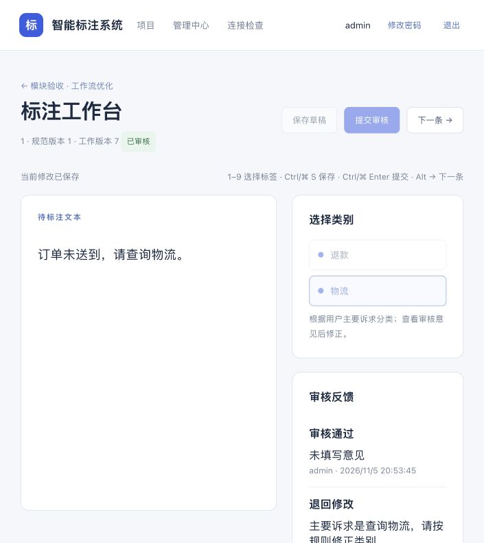

# 工作流优化与模块测试报告

日期：2026-11-05。本文记录当天的基础系统验收；2026-11-06 增加的 Agent 与最新测试结果见 [Agent 实现与使用说明](./Agent实现与使用说明.md)。

## 1. 参考了什么

本轮参考公开产品文档中的工作流约定，没有直接复制第三方源码：

| 参考项目 | 官方资料 | 本项目采用的原则 |
| --- | --- | --- |
| Label Studio | [标注界面与预测来源提示](https://labelstud.io/guide/labeling.html) | 人工标注、导入标签、模型建议分别显示；模型建议经人工采用和审核后才成为成果 |
| CVAT | [审核与问题跟踪](https://www.cvat.ai/post/how-to-ensure-quality-in-image-annotation-with-cvat-ai) | 单独的待审核队列、明确的接受/退回流程、意见反馈可追溯 |
| CVAT | [标注质量控制](https://www.cvat.ai/academy/labeling-quality-control) | 真值与模型输入隔离；质量报告与人工审核分别处理 |

这些项目的具体功能范围与本项目不同。本轮重点改进现有工作流与可靠性，没有加入视频、分割、多人实时协同或 Agent。

## 2. 已完成的优化

| 模块 | 原问题 | 现在的行为 |
| --- | --- | --- |
| 领取与保存 | 保存不检查其他人的领取状态；续约会改变标注版本 | 未到期的他人领取会阻止写入；领取/续约不递增标注版本，提交时释放领取 |
| 规范隔离 | 提交/释放领取的接口未充分检查规范所属项目 | 写入前检查规范属于样本项目且已发布，不能建立跨项目工作状态 |
| 标注验证 | 不合法的框对象、空坐标可能触发服务异常 | 返回明确的参数错误；拒绝非数字、越界、重复 ID 等错误 |
| 模型缓存 | 命中缓存时可能绕过供应商授权/启用检查 | 先检查模型能力、供应商状态与项目授权，再读缓存；损坏缓存重新预测 |
| 用量账本 | 负数或布尔 token 用量可能被错误计入 | 仅接受非负整数用量；缺失/异常用量保留预留，并支持管理员对账 |
| 模型评估 | 不匹配模型、未发布版本可能被排进队列 | 创建任务前校验任务能力、数据/规范发布状态、授权与样本归属 |
| 异步任务 | 执行结束与取消有竞争；全失败仍标为部分失败 | 提交成果前检查取消与租约；全失败明确标为失败；失去租约不能提交成果 |
| 训练 | 长训练缺少协作取消与严格数值检查 | 检查整数范围、学习率等；训练进程轮询取消并停止进程组；测试集不进入训练请求 |
| 模型服务 | YOLO 无效图片可能产生未处理异常 | 无效编码/图片返回 422，超大图片返回 413；类别名称映射仍严格检查 |
| 数据库性能 | 数据列表逐条查询工作状态 | 一个查询批量读取工作状态；加入规范/状态、修订历史、待派发事件索引 |
| 项目页面 | 状态和管理入口对不同角色不够清晰 | 增加各状态数量、审核完成率、待审核队列；隐藏标注员无权使用的管理入口 |
| 工作台 | 样本切换可能保留旧内容；未选择类别也可能保存默认类别 | 路由变化重新加载；旧响应不覆盖新样本，加载失败不保留可编辑旧样本；文本需明确选择类别 |
| 审核反馈 | 标注员看不到退回意见 | 工作台显示审核者、意见、时间和历史决定；审核修正与普通保存区分 |
| 编辑保护 | 保存期间编辑、离开页面、撤销状态缺少保护 | 保存期间禁用编辑；保存失败保留草稿与幂等操作 ID；离开时保存失败会阻止跳转；审核修正未完成时阻止离开 |
| 操作效率 | 工作台依赖鼠标、状态使用内部英文 | 1–9 选择类别、Ctrl/⌘ S 保存、Ctrl/⌘ Enter 提交、Alt → 下一条；工作与任务状态显示中文 |
| 图像画布 | 不能从已有框上开始画重叠框 | 可以绘制重叠目标框；坐标约束抽成可测试函数；只读/忙碌时禁止画框、拖动和删除 |
| 桌面客户端 | 页面直接显示后台任务内部 JSON | 提取复用采集模块，显示中文任务状态、导入数量与错误原因 |
| 运维 | 备份目录权限较宽；恢复先创建库后发现缺文件 | 新备份/恢复目录权限 700；缺少备份文件时不创建恢复数据库 |
| 维护 | 部分源码压缩成很长的行，缺少统一检查入口 | Python 使用 Ruff 格式化并清理未使用导入；Vue/TS 使用 Prettier；新增一键检查脚本 |

## 3. 自动化测试结果

后端：**82 个测试全部通过**。分别使用临时 SQLite 和独立 PostgreSQL `annotation_test` 运行相同测试，两次均无失败、无跳过。后端业务代码语句覆盖率为 **81.7%**，不是全部分支覆盖率。

| 后端测试文件 | 数量 | 主要验证 |
| --- | ---: | --- |
| `test_workflow.py` | 5 | 身份、文本/图像标注、审核、固定导出、YOLO 往返、ZIP 与真值隔离 |
| `test_models_jobs.py` | 4 | 实际本地 HTTP 模型协议、预算阻止调用、任务幂等、恢复与部署参数 |
| `test_regressions.py` | 4 | 已发布规范、最后负责人、审核修正、数据版本/划分、指标已知答案 |
| `test_maturity_regressions.py` | 8 | 占用冲突、跨项目规范、缓存授权、非法框、评估能力、审核意见 |
| `test_security_projects.py` | 9 | CSRF、密码/禁用/退出、过期会话、限流、项目隔离、规范 ID、分页、错误脱敏、批量查询 |
| `test_storage_imports.py` | 13 | 路径穿越、符号链接、并发写入、S3 协议、EXIF、像素限制、CSV 部分失败、COCO 真值 |
| `test_inference_accounting.py` | 11 | 正常/未知/异常用量、对账幂等、供应商错误、HTTP 适配器、缓存与地址限制 |
| `test_tasks_infrastructure.py` | 7 | 调用中取消、禁用创建者、租约恢复、事件补投、服务降级、CLI 初始化与恢复保护 |
| `test_runtime_training.py` | 19 | 四类部署命令与健康协议、无 Docker、检查点限制、训练参数、训练快照、候选注册、进程取消、评估 |
| `test_model_services.py` | 2 | BERT/YOLO HTTP 服务的请求验证、类别映射和响应协议 |

前端：**15 个测试全部通过**，并通过 Vue/TypeScript 检查和生产构建。

- 请求模块：并发刷新只发一个请求、身份过期后携原始写入重试、文件边界、可追踪错误、刷新失效。
- 工作台：明确选择类别、快捷保存、失败保留草稿与操作 ID、离开失败阻止跳转、样本切换、过期响应、加载失败保护、审核反馈、只读审核页。
- 项目与画布：角色入口、坐标裁剪、完成/进行中/失败状态区分。

桌面客户端：**6 个测试全部通过**，验证地址限制、提取文本、排除脚本/导航、空文本、图片字节保留、网络错误和 20 MB 限制；主进程与 preload/renderer 语法检查通过。

前端和客户端 npm 依赖审计均为 **0 个已知漏洞**。测试工具的传递依赖采用已修复版本并记录于锁文件；这不代表没有未知漏洞。

## 4. 本机实际运行验收

1. 浏览器确认前端健康请求成功。
2. 新建“模块验收 · 工作流优化”合成文本项目，真实 Celery Worker 导入 3 条文本。
3. 浏览器完成待审核队列、填写退回意见、显示反馈、人工修正、Ctrl S 保存、重新提交、接受、切换下一样本。审核已完成的审核模式页面为只读。
4. 真实 Worker 导出已审核快照，ZIP 包含 manifest、标签映射及 JSONL；下载结果中的标签与修正结果一致。
5. MongoDB 存在该项目的执行事件；Redis 实测写入、读取和 TTL；检查结束时派发积压为 0。
6. 新备份恢复到 `annotation_restore_qa_20261105` 和新的文件目录。恢复后有 3 个项目、5 条标注修订、4 个导出记录，引用图片存在，迁移版本为 `85c945c82e4f`；原业务库未覆盖。
7. Alembic 检查无待生成结构变更；Compose 结构检查通过，普通 API 没有挂载 Docker socket。

验收样例项目保留在系统中，方便查看流程；自动化测试只读写临时 SQLite 或 `annotation_test`，不会删除业务主库表。



## 5. 如何自己重新测试

从项目 `backend` 目录运行：

```bash
uv sync --locked
uv run python ../scripts/check.py
```

要额外验证本机 PostgreSQL，先启动基础设施，再运行：

```bash
uv run python ../scripts/local_infra.py start
uv run python ../scripts/check.py --postgres
```

脚本检查后端、前端、客户端、依赖审计、Python 语法和 Compose 配置，逐项输出通过/失败；日志、JUnit、覆盖率和结果保存在 `.local/verification/`。任意检查失败时返回非零退出状态。运行前端与客户端检查前分别执行一次 `npm ci` 安装锁定依赖。

单独运行某个模块：

```bash
uv run pytest tests/test_storage_imports.py -q
```

前端在 `frontend` 目录运行 `npm test`；客户端在 `client` 目录运行 `npm test`。

## 6. 本轮测试的边界

- 部署命令、健康协议和 BERT/YOLO 服务协议已测试，其中 Docker 和 ML 库使用受控替代对象。**没有实际构建 Docker 镜像、加载真实权重或在 GPU 上训练。**
- 本地 HTTP 测试服务验证模型调用格式、预算与错误处理，不证明供应商兼容性或模型准确率。
- S3 验证读写协议与流关闭，不是远端对象存储灾难恢复演练。实际文件备份/恢复使用本机存储。
- 训练取消已验证进程停止；Docker build/pull 等阻塞阶段的取消延迟仍需在目标平台验证。
- 本轮不是大规模负载测试、完整渗透测试或论文实验。未覆盖分支仍应随具体功能扩展补充。
- Starlette 的测试客户端存在非失败的 httpx 迁移提示，当前测试正常运行。
