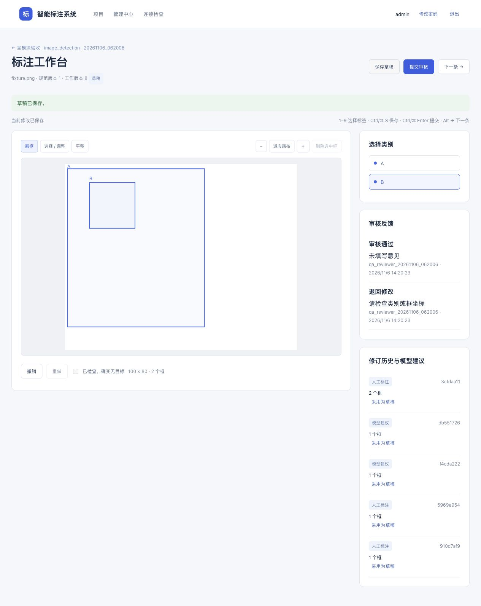

# 全模块运行验收与问题修复报告

日期：2026-11-06。本机 macOS ARM，使用正在运行的 FastAPI、Vue、PostgreSQL、MongoDB、Redis 与 Celery。

## 1. 结论与范围

本轮进行了自动化回归、真实 HTTP/后台队列验收、浏览器实际操作和隔离备份恢复，确认并修复了 4 类问题。修复后，覆盖范围内的基本标注与 Agent 工作流通过验收。

真实模型 API、模型权重、GPU 训练和 Docker 镜像启动未验收。模型服务使用明确标记的本地协议测试服务；这些结果验证工程行为，不证明模型理解能力或标注准确率。

Electron 进程已实际启动并在修复后重启。本轮电脑控制工具未能取得它的可操作窗口，因此没有宣称完成桌面窗口的按钮、键盘和布局验收。客户端的真实会话、文本/图片采集、导入、任务查询与退出流程通过 Node 调用同一主进程业务模块完成。

## 2. 本轮修复

| 问题 | 触发条件与影响 | 修复与回归 |
| --- | --- | --- |
| 训练回调被覆盖 | ML 依赖检查用 `check` 保存子进程结果，覆盖取消/租约回调；训练执行器调用它时出现 `TypeError` | 改为 `dependency_check`；补强训练快照测试，要求执行器实际调用传入回调。修改前复现失败，修改后通过 |
| 未就绪模型回退旧服务 | 普通预测与评估没有统一检查部署状态；失败/停止的部署可能使用旧 endpoint，项目选择器也列出候选和不可用模型 | 增加 `ensure_model_available`；创建任务和读取预测缓存前检查；项目使用专用可用模型接口；Agent 共用校验。增加失败、停止、未部署候选三个回归场景 |
| 图像逐框分数丢失 | HTTP 插件将分数放在 `signals.box_scores`，框中没有 `score` 时，网关将有效分数覆盖成空值 | 按每框显式分数、对应信号分数、缺失值的顺序取值；回归验证低分复核信号；真实图像评估和 Agent 汇总验证 |
| 客户端令牌过期中断 | 桌面客户端只保存 15 分钟 access token，没有刷新 Cookie 与刷新流程 | 新增主进程会话模块，内存保存刷新 Cookie，处理过期、并发与延迟 401；写入重试保留文件与幂等键；新增退出入口。增加 5 个测试，并用真实 API 的过期 JWT 验证刷新后继续采集 |

主要代码：

- `backend/app/training.py`：训练入口与子进程回调。
- `backend/app/inference.py`：模型可用性和分数处理。
- `backend/app/api.py`：预测/评估校验与 `GET /api/v1/projects/{project_id}/models`。
- `backend/app/agent/tools.py`：Agent 兼容模型查询共用校验。
- `frontend/src/views/ProjectView.vue`：只使用项目可用模型，失效选项清空。
- `client/session.cjs`、`main.cjs`、`renderer.js`：会话刷新、业务接入、退出及登录失败的界面状态。
- `backend/tests/test_live_findings.py`、`client/tests/session.test.cjs`：新增回归；训练测试补强原场景。

## 3. 自动化结果

| 检查 | 最终结果 |
| --- | --- |
| 后端 SQLite | 106 项通过，0 失败，0 跳过 |
| 后端 PostgreSQL | 同一套 106 项通过，使用独立 `annotation_test` 数据库 |
| 后端业务语句覆盖率 | 82.5%，不是分支覆盖率，也不是端到端覆盖率 |
| 前端 | 20 项通过，Vue/TypeScript 检查及生产构建通过 |
| 客户端 | 11 项通过，主进程、会话、preload、renderer 语法检查通过 |
| npm 审计 | 前端与客户端均为 0 个已知漏洞 |
| 数据库迁移 | `alembic check` 无新增结构差异，版本 `2163375d0eed` |
| 静态检查 | Python 源码语法、未使用导入和 Compose 服务结构通过 |

后端的 106 项包含 20 项 Agent 测试及 4 项本轮新增的模型回归。客户端原 6 项采集测试加 5 项会话测试。

最新日志、JUnit、覆盖率与汇总保存在 `.local/verification/`。测试使用临时 SQLite 与独立 PostgreSQL 测试库。

## 4. 真实运行验收

| 模块 | 实际操作与检查 | 结果 |
| --- | --- | --- |
| 身份会话 | HTTP 登录、未登录 401、请求编号、刷新 Cookie 轮换、旧令牌重放拒绝、临时账号禁用 | 通过 |
| 项目与成员 | 新建专用文本/图像项目；负责人、标注员、审核员、外部账号；跨项目拒绝；发布规范不可修改 | 通过 |
| 导入与版本 | JSONL/PNG/COCO ZIP 真实导入队列；复制版本、数据划分和发布 | 通过 |
| 文本标注 | 领取冲突、重复保存幂等、过期版本冲突；退回、修改、重提、独立账号审核 | 通过 |
| 图像标注 | 原图获取、非法坐标拒绝、真实框标注与独立审核 | 通过 |
| 导出 | JSONL、CSV、YOLO、COCO 都经实际 Worker 生成；读取 ZIP 内容与 manifest；外部账号不能下载 | 通过 |
| 模型与缓存 | 文本/图像 HTTP 请求；第二次预测命中 Redis、上游请求次数不增加；预测不改变已有审核状态 | 通过 |
| 大模型接口 | 本地 OpenAI 协议服务连接测试、预测调用、用量账本、预算不足失败 | 工程协议通过 |
| Agent | 文本规划、工具执行、等待/恢复、补充信息、继续；图像预标注及低分原因汇总 | 工程流程通过 |
| 任务取消 | 让模型请求保持进行中，发出取消，再返回响应；任务结束为取消状态 | 通过 |
| 模型可用性 | 部署失败的独立模型规格不在可用列表，直接调用预测 API 也被拒绝 | 通过 |
| 训练 | 仅有 train 已审核数据时，真实训练任务明确拒绝并要求 val；回调衔接通过回归验证 | 数据保护通过，实际训练未验收 |
| 部署 | 真实部署队列明确报告 Docker 不可用 | 失败处理通过，容器启动未验收 |
| 评估 | 独立真值导入、标注界面不暴露真值；真实评估队列生成文本与检测指标 | 通过 |
| 数据库与事件 | PostgreSQL、MongoDB、两个 Redis 在线；业务审计、Mongo 事件；收尾时 Outbox 与排队任务为 0 | 通过 |
| 客户端 | 真实过期令牌 401 后刷新一次；提取静态文本并排除脚本/导航；保留图片字节；两种资料均导入成功；退出清理会话 | 主进程业务模块通过 |

文本指标合成用例只有 A 类真值，accuracy 为 1、按全部两个标签计算的 macro-F1 为 0.5；无样本的 B 类按零 F1 计入。这是当前指标定义的已知结果，不是算法质量结论。检测用例的框与合成真值一致，AP50 与 AP50:95 均为 1，同样只用于核验计算链路。

## 5. 浏览器验收

实际使用 Web 页面完成：

1. 打开专用文本项目，采用模型候选为本地草稿，使用 ⌘S 保存，再提交审核。
2. 当前项目禁止本人审核时，点击接受得到明确提示，状态保持待审核。
3. 图像画布上选择 B 类，在已有框内部绘制重叠框；撤销恢复一个框，重做恢复两个框，再保存。
4. 读取后端保存结果，两个框的坐标均位于原图 100×80 范围内。
5. 从页面下载此前冻结的 COCO ZIP；当前图像已被修改为两个框，旧导出仍包含原审核版本的一个框。
6. 检查 Agent 配置/技能与管理员运行状态页面；浏览器没有记录到控制台 error/warn。



## 6. 备份恢复

执行了真实 PostgreSQL dump、文件归档及 MongoDB dump，然后恢复到新的目标：

- PostgreSQL：`annotation_restore_fullqa_20261106_142652`。
- 文件目录：`.local/runtime-acceptance/restored-20261106-142652/`。
- MongoDB：`annotation_restore_fullqa_20261106_142652`，使用独立 `mongorestore` 命令映射命名空间。

恢复库的迁移版本正确，包含 10 个项目、38 条标注修订、4 个 Agent 运行及 7 条工具记录。检查了 4 个引用图片对象，恢复文件与源文件 SHA-256 一致。MongoDB 恢复 316 条事件且索引恢复成功。计数来自备份时点，后续测试新增记录不包含在该备份中。

现有 `restore.py` 负责 PostgreSQL 与文件，MongoDB 恢复仍需显式命令；这项能力可以后续整合为统一恢复入口。Redis 缓存不作为恢复业务事实的来源。

## 7. 复验方式与证据

完整自动化检查：

```bash
cd /Users/bytedance/learn/futureproject/backend
uv run python ../scripts/check.py --postgres
```

真实运行验收需要 API、普通 Worker、Agent Worker、派发器和基础设施已启动，并有本机 `.local/admin-password`：

```bash
uv run python ../scripts/runtime_acceptance.py
```

可加 `--serve` 暂时保留本地资料/模型协议服务，供 Web 或客户端联调；Ctrl+C 后会停用本轮测试配置、供应商、临时账号，并把协议模型移出可用候选。成功项目与记录保留便于查看；中间失败的验收项目已归档。

附加脚本 `live_additional_smoke.py` 要求协议服务仍运行、并且已在对应项目完成文本提交和图像两个框的保存。`client_live_smoke.cjs` 用同一个客户端业务模块进行真实网络验收；其过期令牌文件需在本机测试时准备，执行后删除，脚本不打印登录密码或令牌。

证据保存在 `.local/runtime-acceptance/`：

| 文件 | 内容 |
| --- | --- |
| `report.json` | 主 HTTP/真实队列验收记录 |
| `additional-live.json` | 评估、图像 Agent、部署阻止、浏览器保存坐标 |
| `client-live.json` | 实际客户端会话刷新与两种资料导入 |
| `browser-download.json` | 浏览器下载的 COCO 冻结快照检查 |
| `restore-verification.json` | 迁移、业务计数、图片与 Mongo 恢复检查 |
| `*_jsonl.zip` 等 | 实际导出产物 |

## 8. 仍需后续验证或改进

1. **真实模型与论文实验**：配置真实 Claude/API、部署实际 BERT/YOLO 权重后，验证模型协议兼容性、失败场景、成本与标注质量。当前协议测试服务不用于准确率结论。
2. **GPU/Docker 环境**：验证镜像构建、加载权重、长任务取消、显存不足、训练产物、停止与重启后的健康状态。本机未具备这些条件。
3. **桌面窗口验收**：在可操作 Electron 窗口的环境检查登录/退出按钮、项目选择、两种采集类型、错误提示和布局。
4. **规模与体验**：当前是小规模功能验收。可增加大文件、长队列与多人并发负载测试；项目页目前轮询多组接口，规模扩大后应分区加载、分页及减少重复查询。
5. **错误展示与恢复入口**：管理页面仍展示部分 JSON 诊断信息，可改为按错误码展示解释与处理步骤；整合 Mongo 恢复、服务启动与验收报告入口，降低初学者的操作成本。

通过本轮测试不等于不存在未覆盖问题。上述边界在真实资源可用后应继续验证。
