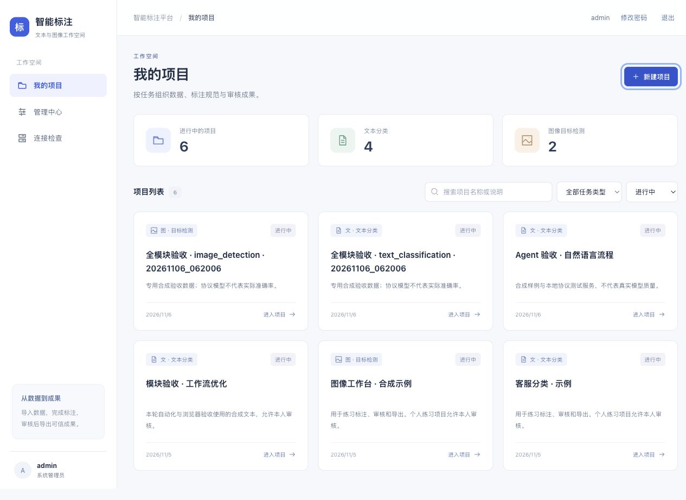
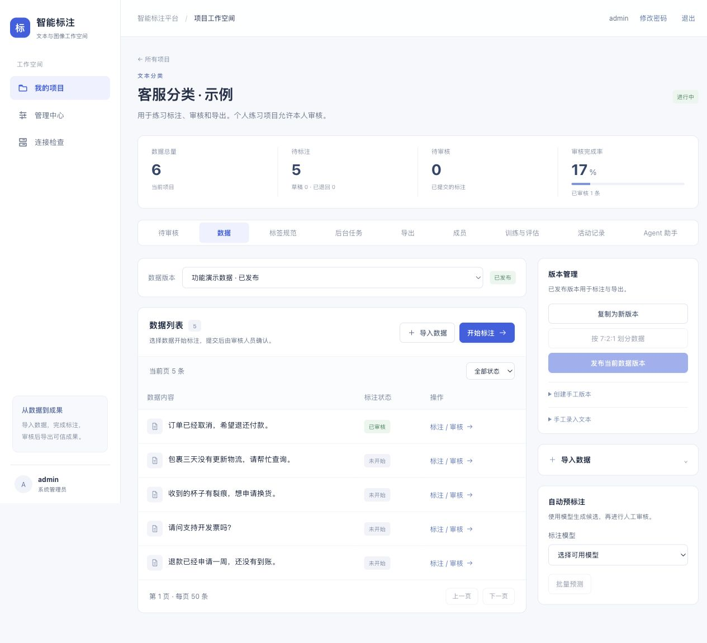
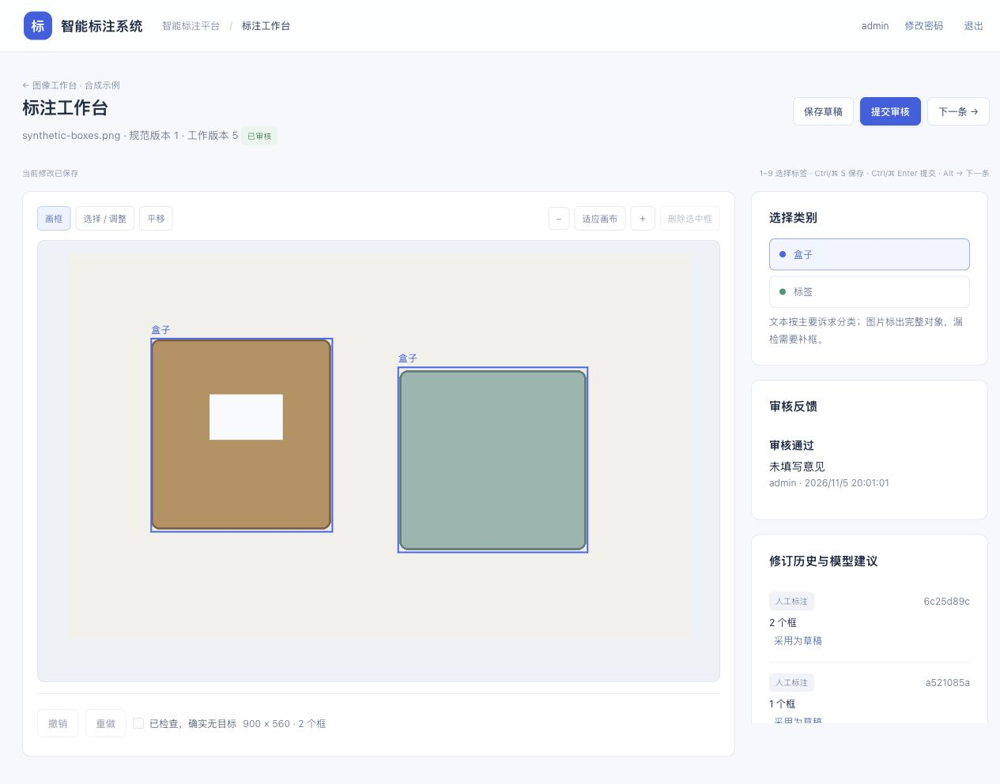
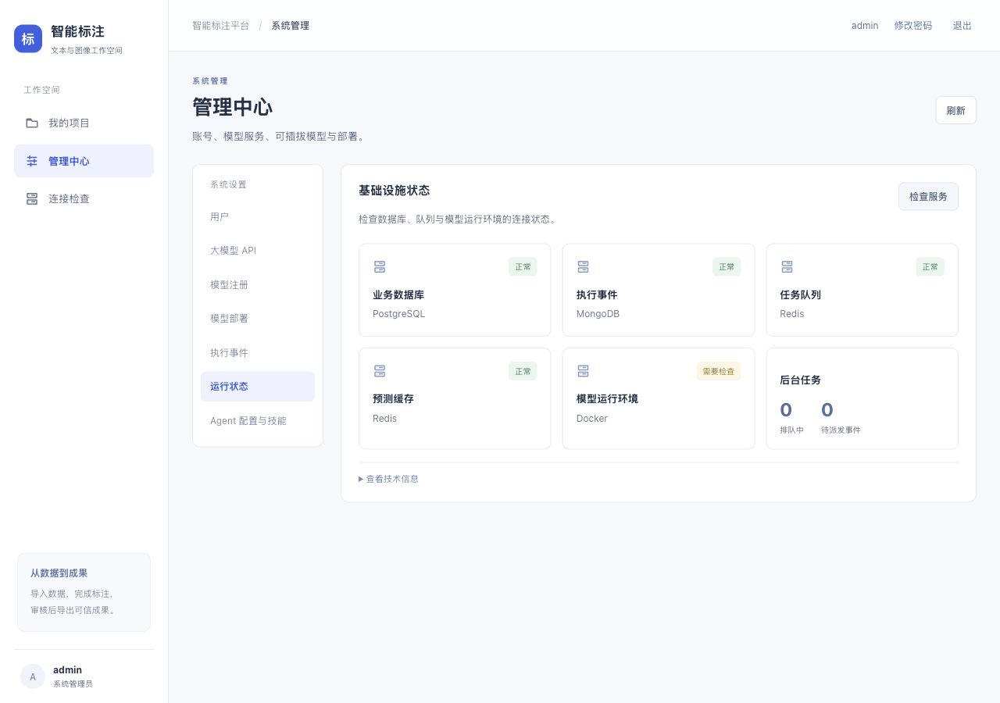

# 前端布局优化说明

日期：2026-11-06。

## 1. 调整目标

优先展示数据与标注操作，把数据准备、配置和诊断信息放到对应分区。统一导航、卡片、表格、按钮及间距，并适配窄窗口。

## 2. 新版页面怎么使用

| 页面 | 新布局与操作位置 |
| --- | --- |
| 全局导航 | 桌面左侧固定“我的项目 / 管理中心 / 连接检查”，顶部显示当前位置和账号操作；窄窗口点击左上角菜单展开 |
| 项目首页 | 顶部显示进行中的项目数量与任务类型数量；下方搜索名称/说明、筛选任务类型和状态；默认显示进行中的项目，归档项目可通过状态筛选查看 |
| 新建项目 | 点击右上角“新建项目”打开弹窗；支持关闭按钮、点击遮罩和 Esc；关闭后焦点回到入口 |
| 项目数据页 | 主区域先展示版本选择与数据列表；右侧为版本管理、可展开的导入表单和自动预标注；标注员使用整行数据列表 |
| 数据准备 | “创建手工版本”和“手工录入文本”在版本管理中展开；导入按钮可直接展开侧栏表单；按版本状态启用划分、发布和录入操作 |
| 开始标注 | 数据列表右上角“开始标注”打开当前列表中待处理的样本；表格中也可以指定具体数据 |
| 标注工作台 | 使用完整页面宽度，保存、提交、下一条保留在顶部工具栏；类别、审核和历史放在右侧；画布随窗口高度调整 |
| Agent | 四个配置字段集中排列；下方分成运行历史与执行详情；窄窗口自动改为单列 |
| 管理中心 | 左侧为管理模块导航，右侧为当前内容；用户表给用户名更多宽度；运行状态用卡片显示，原始 JSON 收起到“查看技术信息” |

移动端表格在自身区域横向滚动，页面本身不横向越界。长表单改为单列，工作台类别与历史移到画布下方。

## 3. 主要文件

- `frontend/src/assets/system.css`：统一样式和响应式布局。
- `frontend/src/App.vue`：导航、当前位置、窄屏菜单与修改密码弹窗。
- `frontend/src/views/ProjectsView.vue`：首页统计、搜索、状态/类型筛选、项目卡片。
- `frontend/src/views/ProjectView.vue`：数据主区域、准备侧栏、紧凑统计和版本操作状态。
- `frontend/src/views/AdminView.vue`：模块侧栏、用户表和运行状态卡片。
- `frontend/src/views/AnnotationView.vue`：工作台工具栏与侧栏。
- `frontend/src/components/AgentPanel.vue`：配置网格、历史与执行详情。
- `frontend/src/components/AppIcon.vue`：统一 SVG 图标。
- `frontend/src/components/ModalDialog.vue`：原生对话框，焦点限制、Esc、遮罩关闭。
- `frontend/src/router.ts`：新页面回到顶部，返回历史时恢复滚动位置。

## 4. 验证

前端 20 项已有回归测试通过，Vue/TypeScript 检查和生产构建通过。

浏览器实际检查了：

- 项目搜索、归档状态筛选、版本切换、导入分区展开/收起。
- 新建项目弹窗打开与 Esc 关闭、焦点恢复。
- “开始标注”进入对应样本、文本与图像工作台、画布和工具栏。
- 管理中心导航、真实服务状态卡片、Agent 窄屏配置区。
- 1280×900 桌面视口、390×844 与 320×760 窄屏。
- 窄屏菜单展开及切换后收起、新页面滚动到顶部。

测量页面的 `scrollWidth` 与 `clientWidth`：桌面数据页 1265/1265，390 宽度的数据/管理页 375/375，320 宽度的数据页修正后 305/305。差值为零，页面没有整体横向溢出；桌面浏览器垂直滚动条占用了视口中的 15 像素。

本轮是前端布局和交互验收；后端功能验收见 [全模块运行验收报告](./全模块运行验收与问题修复报告.md)。

## 5. 页面截图

项目首页：

项目数据页：

图像工作台：

管理中心：

