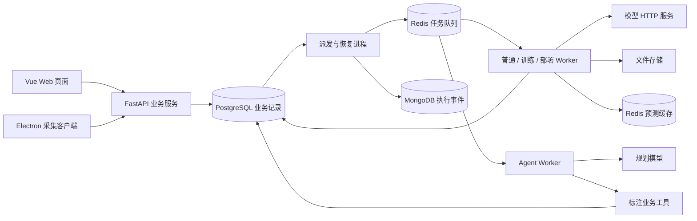
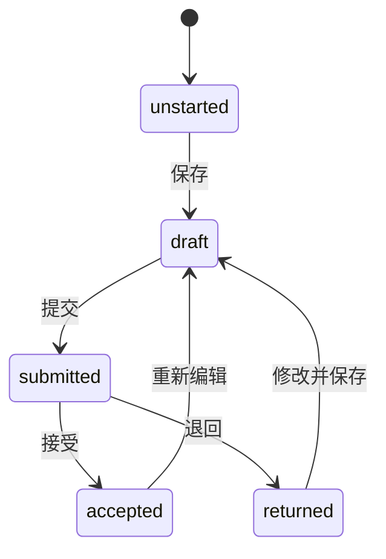
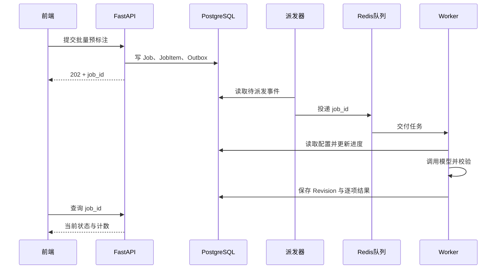

# 整个项目的零基础代码导读

日期：2026-11-06。本文对照当前实际代码，解释项目怎样构建、各部分怎样协作，以及怎样逐步阅读和练习。

适合先了解 Python、Vue、HTTP 和数据库的基本含义，再沿着一个功能阅读代码。文中的短代码用于解释实际实现中的关键步骤，省略了部分错误处理，不能直接代替完整函数。

## 1. 先理解系统完成什么

目前的两种标注任务是：

- 文本分类：给一段文本选择一个类别，例如退款、物流、商品质量。
- 图像目标检测：在图片上画目标框，并给每个框选择类别。

完整工作流：

```text
创建项目 → 发布标签规范 → 导入数据版本
    → 人工标注 / 模型预标注 → 提交审核 → 接受或退回
    → 导出审核成果 → 训练与评估
```

Agent 连接已有业务工具，让用户用自然语言组织上述部分操作。当前自动动作是预标注、已审核导出和结果汇总。

## 2. 各种技术分别负责什么

| 技术 | 解决的问题 | 本项目中的位置 |
| --- | --- | --- |
| HTML | 页面有哪些内容和表单 | Vue 文件中的 template |
| CSS | 布局、颜色、字体和不同窗口大小 | frontend/src/assets/ |
| TypeScript | 前端状态、事件、请求和类型检查 | Vue 文件中的 script、各个 ts 文件 |
| Vue 3 | 数据变化时更新界面，组织页面与组件 | frontend/src/ |
| Vue Router | URL 对应哪个前端页面 | frontend/src/router.ts |
| Vite | 开发时提供页面、热更新、代理；发布时打包 | frontend/vite.config.ts |
| FastAPI | 接收 HTTP 请求并执行后端业务 | backend/app/main.py、api.py |
| Uvicorn | 监听端口，将请求交给 FastAPI | main.py 启动入口 |
| Pydantic | 检查请求的字段、类型、长度和范围 | backend/app/schemas.py |
| SQLAlchemy | 用 Python 对象组织数据库查询与事务 | models.py、db.py 和业务代码 |
| Alembic | 保存和执行数据库结构升级步骤 | backend/alembic/ |
| PostgreSQL | 保存可靠的业务记录与关系 | 用户、项目、版本、标注、任务等 |
| MongoDB | 保存执行事件文档，供活动查看 | tasks.py 的事件派发 |
| Redis | 缓存预测，以及承担 Celery 队列的消息传递 | 两个独立实例 |
| Celery | 在后台 Worker 中运行耗时任务 | backend/app/tasks.py |
| 模型服务 | 实际执行文本分类或目标检测 | model_services/ |
| Claude Agent SDK / HTTP 规划引擎 | 将自然语言组织成受约束的计划 | backend/app/agent/ |
| Electron | 提供桌面资料采集窗口 | client/ |
| Nginx / Docker Compose | 发布静态页面、代理接口、组织服务进程 | deploy/ |

前端负责展示与交互；后端负责权限、规则和业务写入；数据库负责持久化。关掉浏览器会丢失未保存的页面状态，数据库中的已提交记录仍然存在。

## 3. 总体结构



图中的箭头表示依赖或数据流，不全是 HTTP 请求。前端、客户端和外部模型通信使用 HTTP；后端内部的工具调用可以直接调用 Python 函数。

## 4. 工程目录

```text
futureproject/
├── frontend/                  Vue + TypeScript
│   ├── src/main.ts            创建并挂载 Vue 应用
│   ├── src/App.vue            全局导航和页面容器
│   ├── src/router.ts          页面 URL 与组件的对应关系
│   ├── src/views/             项目、工作台、登录、管理页面
│   ├── src/components/        画布、Agent、图标、弹窗
│   ├── src/api/http.ts        业务请求、登录、刷新、文件下载
│   ├── src/domain/            状态中文名称、坐标辅助函数
│   ├── src/assets/            公共样式
│   ├── tests/                 前端测试
│   └── vite.config.ts         开发服务器与代理
├── backend/
│   ├── app/main.py            FastAPI 入口、错误处理、健康接口
│   ├── app/api.py             主要业务 API 与事务用例
│   ├── app/schemas.py         请求数据结构
│   ├── app/models.py          业务数据库表
│   ├── app/db.py              数据库连接与 Session
│   ├── app/security.py        登录凭证、权限、加密与审计
│   ├── app/annotations.py     标签、坐标、工作状态及幂等校验
│   ├── app/imports.py         导入、图片规范化、导出打包
│   ├── app/storage.py         本机 / S3 文件存储
│   ├── app/inference.py       模型适配、用量、缓存
│   ├── app/tasks.py           后台任务、派发、恢复
│   ├── app/job_control.py     任务取消与租约检查
│   ├── app/runtime.py         固定模型部署模板
│   ├── app/training.py        训练快照、训练进程与评估指标
│   ├── app/agent/             规划、技能、工具与持久工作流
│   ├── alembic/               数据库迁移
│   ├── tests/                 后端测试
│   ├── pyproject.toml         Python 依赖声明
│   └── uv.lock                锁定的依赖版本
├── model_services/            BERT / YOLO 服务与训练脚本
├── client/                    Electron 采集客户端
├── scripts/                   初始化、基础设施、备份、恢复、验收
├── deploy/                    Dockerfile、Compose、Nginx
├── docs/                      设计、学习与验收说明
└── .local/                    本机开发数据库、测试报告、备份等
```

`backend/.venv` 是 uv 管理的 Python 环境，`frontend/node_modules` 是前端依赖，`frontend/dist` 是打包结果。应用图片与导出文件位于配置的 `STORAGE_ROOT`，本机默认 `backend/data`。

## 5. 开发顺序：每次完成一个可运行功能

实际推进时先建立最小 FastAPI 服务和 Vue 页面，让健康请求成功；随后加入数据库与业务模块，再接模型和 Agent，最后通过真实运行发现问题并调整布局。

每个模块基本都沿着同一种顺序：

1. 说明用户要完成的动作与成功结果。
2. 确定保存哪些字段、哪些关系、哪些状态。
3. 定义 API 输入、输出和权限。
4. 实现数据库写入及业务校验。
5. 用 API 文档或测试单独验证后端。
6. 在前端接入请求、显示状态与错误。
7. 验证重复操作、权限不足、数据错误和网络失败。

例如“创建项目”完成后，再实现“项目里导入数据”；“人工标注”与“模型预测”都可用后，再让 Agent 调用它们。测试贯穿每一步。

## 6. 从一次创建项目看完整请求

假设你创建“客服分类”，任务类型选文本分类。

### 6.1 页面收集输入

`ProjectsView.vue` 中用 `ref` 保存输入：

```ts
const name = ref("");
const taskType = ref("text_classification");
```

模板用 `v-model` 将输入框与变量关联：

```vue
<input v-model="name" />
```

输入框发生变化，`name.value` 同步变化。Vue 在模板中会自动解开 ref，所以模板写 `name`，脚本写 `name.value`。

### 6.2 发出 POST 请求

创建函数的关键步骤：

```ts
await post("/projects", {
  name: name.value,
  description: description.value,
  task_type: taskType.value,
});
await load();
```

`post` 来自 `frontend/src/api/http.ts`。它将 JavaScript 对象用 `JSON.stringify` 转成 JSON，调用统一的 `api` 函数。

浏览器实际发送到：

```text
POST /api/v1/projects
Content-Type: application/json
Authorization: Bearer <当前访问令牌>
```

请求正文类似：

```json
{
  "name": "客服分类",
  "description": "识别用户的主要诉求",
  "task_type": "text_classification"
}
```

### 6.3 Vite 将请求转发给后端

浏览器访问开发页面的 5173 端口。`vite.config.ts` 中将 `/api` 请求转发到 8000 端口。

```text
浏览器 → 5173/api/v1/projects → Vite 代理 → 8000/api/v1/projects
```

因此开发页面使用 `/api/v1/...` 相对地址。当前开发实现没有依赖一个额外的前端跨域放行方案；代理与后端的来源检查共同参与请求处理。

### 6.4 FastAPI 校验请求并确定身份

`api.py` 中注册：

```python
@router.post("/projects", status_code=201)
def add_project(body: ProjectInput, user=Depends(current_user), db=Depends(get_db)):
    ...
```

该 router 的统一前缀是 `/api/v1`，所以完整路径是 `/api/v1/projects`。

- `ProjectInput`：检查项目名、任务类型、字段长度等。
- `Depends(current_user)`：验证访问令牌，从数据库取得当前用户。
- `Depends(get_db)`：取得本次请求的数据库 Session。

这些函数在业务函数执行前准备好参数。项目创建者由服务端的当前用户决定。

### 6.5 写入数据库并提交

创建项目还需要建立负责人关系，因此一个事务中写两类记录：

```python
project = Project(**body.model_dump(), created_by=user.id)
db.add(project)
db.flush()
db.add(Member(project_id=project.id, user_id=user.id, role="owner"))
record(db, "project.created", user.id, project.id)
db.commit()
```

- `add`：将新对象交给 Session。
- `flush`：把待写内容发送给数据库，仍处于当前事务。
- `commit`：提交这批相关变更。
- `rollback`：发生错误时撤销本次未提交变更。

项目、负责人和相关审计需要一起成功。`flush` 不能代替 `commit`。

### 6.6 返回数据并更新界面

后端返回包含项目 ID 的 JSON，状态码是 201。前端 `await post(...)` 完成后重新读取项目列表：

```ts
projects.value = await api("/projects");
```

模板用 `v-for` 渲染列表。`projects.value` 改变，Vue 更新卡片。刷新页面后仍可读取项目，因为记录已提交到 PostgreSQL。

## 7. 三种容易混淆的“模型/规范”

| 名称 | 含义 | 例子 |
| --- | --- | --- |
| Pydantic 请求结构 | HTTP 请求允许哪些字段和类型 | ProjectInput、RevisionInput |
| SQLAlchemy 数据模型 | 数据库表有哪些列与关系 | Project、Item、Revision |
| 标注业务规范 | 这个项目有哪些标签和规则 | LabelSchema 中的退款/物流标签 |

`schemas.py` 主要是请求结构；`models.py` 主要是数据库结构；数据库中的 `LabelSchema` 则是业务里的标签规范。

## 8. 数据库设计

### 8.1 PostgreSQL 保存业务事实

用户、项目、成员、数据版本、标注修订、审核、任务和 Agent 运行都保存在 PostgreSQL。数据库表之间通过 ID 关联。

| 表组 | Python 类 | 保存什么 |
| --- | --- | --- |
| 账号会话 | User、RefreshSession | 密码哈希、账号状态、刷新会话 |
| 项目权限 | Project、Member | 项目和用户在项目中的角色 |
| 标签规范 | LabelSchema | 标签 ID、名称、规则、版本和发布状态 |
| 数据与版本 | Item、Dataset、DatasetItem | 原始样本、版本、版本中的样本及划分 |
| 标注与审核 | Work、Revision、Review | 当前工作状态、每次结果和审核决定 |
| 独立真值 | Reference | 用于评估的参考标签 |
| 模型服务 | Provider、ProviderGrant、ModelSpec、Deployment | 供应商、授权、适配器和部署记录 |
| 后台任务 | Job、JobItem、ModelCall | 总任务、逐样本进度、模型调用用量 |
| 成果与事件 | Export、Audit、Outbox | 导出快照、可靠审计、待派发消息 |
| Agent | AgentConfig、AgentSkill、AgentRun、AgentToolCall | 配置、技能、运行和工具记录 |

本机当前是 26 张业务表，加上 Alembic 版本表共 27 张。

### 8.2 原始数据、版本、修订和状态分别保存

例子：文本“包裹三天没更新”可能出现在两个数据版本中，而你会多次修改它的标签。

- `Item`：这段原始文本本身。
- `DatasetItem`：它属于哪些版本，在各版本里是 train、val 还是 test。
- `Revision`：某一次给它标出的结果。
- `Work`：在某个标签规范下，当前是草稿、待审核还是已审核。
- `Review`：审核者对某一个提交修订作出的决定。

同一样本可属于多个数据版本，因此使用中间表 `DatasetItem`。复制版本主要复制成员关系，复用原始样本。

当前 `Work` 是“样本 + 标签规范”的状态，不是“数据版本 + 样本”的独立状态。同一样本在多个数据版本里会共享该规范下的标注历史和工作状态，导出时再固定需要的修订。

### 8.3 JSON 内容仍然可以保存在 PostgreSQL

类别结果与多个框的结构不同，因此 `Revision.content`、配置和技能快照使用 JSON。PostgreSQL 下采用 JSONB，SQLite 测试下采用 JSON。

这是关系型数据库中的一个灵活字段，不等于把整套业务改成非关系型存储。

### 8.4 MongoDB 与 Redis 的职责

MongoDB 保存执行事件文档。必要业务审计首先在 PostgreSQL 中保存，再通过 Outbox 派发到 MongoDB。

当前没有实现“同一套标注业务分别以 PostgreSQL 和 MongoDB 完整运行”的两套后端。若要做这一类毕业实验，需要补充 MongoDB 业务存储实现与对照实验。

Redis 有两个实例：一个供 Celery 传递任务消息，另一个缓存模型预测。任务状态、已保存标注和审核成果由 PostgreSQL 保存。

### 8.5 用 Alembic 管理结构升级

修改 ORM 类只改变 Python 对数据库结构的描述。已有数据库还需要迁移升级。

```bash
cd /Users/bytedance/learn/futureproject/backend
uv run alembic revision --autogenerate -m "describe_change"
uv run alembic upgrade head
uv run alembic check
```

前两条分别生成升级草稿与执行升级；自动生成后需要检查迁移内容。最后一条检查 ORM 与数据库是否还有待生成差异。这是将来修改结构时的学习步骤，当前学习阅读不需要生成新迁移。

## 9. 前端怎样组织

### 9.1 入口与路由

`main.ts` 创建 Vue 应用、引入样式、安装 router，然后挂载到页面的 `#app`。

`App.vue` 是页面外壳：导航、当前位置、账号操作和 RouterView。`RouterView` 根据当前 URL 显示不同组件。

| 前端 URL | 页面 |
| --- | --- |
| `/login` | LoginView.vue |
| `/` | ProjectsView.vue |
| `/projects/:id` | ProjectView.vue |
| `/annotate/:id` | AnnotationView.vue |
| `/admin` | AdminView.vue |
| `/health` | HealthView.vue |

浏览器的 `/projects/:id` 显示页面，HTTP `/api/v1/projects/{project_id}` 返回 JSON，这是两套路由。

### 9.2 一个 Vue 文件的三部分

```vue
<script setup lang="ts">
// 状态、函数、请求和组件导入
</script>

<template>
  <!-- 页面结构、数据绑定和事件 -->
</template>
```

本项目主要用公共 CSS；组件也可以有自己的 style 块。

| 语法 | 作用 | 项目中的例子 |
| --- | --- | --- |
| ref | 保存会变化的页面状态 | 当前标签、项目列表、错误、busy |
| computed | 根据其他状态计算结果 | 搜索后的项目、是否可管理 |
| v-model | 输入框与状态同步 | 项目名、模型选择、审核意见 |
| v-for | 根据数组生成多个元素 | 项目卡片、数据行、标签按钮 |
| v-if | 根据条件显示内容 | 审核按钮、管理侧栏、错误提示 |
| @click | 点击后执行函数 | 保存、发布、打开导入分区 |
| :disabled | 根据状态禁用控件 | 请求中防止重复操作 |
| onMounted | 页面挂载时执行 | 读取项目和数据 |
| onUnmounted | 离开时清理资源 | 释放计时器、领取和画布 |

`async/await` 让前端按“发请求、等响应、更新状态”的顺序表达流程。等待网络不会把整个页面的渲染线程变成同步阻塞代码。

### 9.3 页面与组件分工

`ProjectView` 读取项目数据，并管理选中的版本、页面分区等。`ImageEditor` 专门处理画布。`AgentPanel` 专门处理 Agent 指令和运行历史。

父组件通过 props 把数据传入子组件；子组件通过 emit 报告变化。例如画布收到 boxes，画框后发出 `update:modelValue`，父页面更新 boxes，保存时再提交后端。

### 9.4 请求统一处理

`http.ts` 集中处理：

- `/api/v1` 前缀和 JSON 编码。
- Authorization 请求头。
- 访问令牌过期后的刷新与一次重试。
- 错误消息、错误码和请求编号。
- 文件上传边界、图片 Blob 与导出下载。
- 后台任务的 Idempotency-Key。

文件上传使用 FormData，让浏览器生成 multipart 边界；普通对象使用 JSON。

当前部分复杂业务状态仍使用 `any`。阅读已有代码后，可以逐步为 Project、Dataset、Work、Revision 和 Job 补充 TypeScript 接口，减少字段拼写错误。

## 10. 身份与权限

登录包含两条线：验证账号，随后验证每次操作的身份与权限。

1. 创建账号时，用 Argon2 保存密码哈希。
2. 登录时验证输入密码与哈希，检查账号是否启用。
3. 返回短期 JWT access token，当前默认 15 分钟。
4. 浏览器以 `Authorization: Bearer ...` 请求业务接口。
5. 后端验证签名、过期时间及用户的 token_version，再读取用户状态。
6. 通过 Member 检查用户是否属于项目，以及 owner、annotator、reviewer 角色是否允许当前动作。

全局管理员也在后端经过检查。前端隐藏或禁用按钮用于帮助用户操作，权限最终由后端决定。

刷新凭证是另一种随机字符串，放在 HttpOnly Cookie 中，数据库保存它的哈希。刷新时旧凭证被撤销、生成新凭证；重放已经用过的旧凭证会撤销该会话族。

前端访问令牌放在当前页面内存，刷新页面后用 Cookie 恢复会话。

| 数据 | 使用的机制 | 原因 |
| --- | --- | --- |
| 用户密码 | Argon2 哈希 | 验证密码，不恢复明文 |
| access token | JWT 签名 | 验证声明的真实性与期限；签名不是内容加密 |
| 刷新凭证 | 随机字符串 + 哈希记录 | 跟踪、轮换和撤销会话 |
| 模型 API Key | Fernet 加密 | 后端调用供应商时需要恢复使用 |

JWT 签名密钥与 API Key 加密主密钥分别配置在环境中。

## 11. 数据导入与文件存储

上传文件后，API 先检查权限、大小、用途和规范等参数，保存上传对象，并创建导入任务。Worker 再解析文件。

- 文本：CSV、JSONL。
- 图像：单图片、ZIP、YOLO、COCO。
- 同一项目中内容相同的样本按哈希复用。
- 逐条错误会记录来源，允许报告部分成功。
- 标签用途 `seed` 写外部候选修订，等待人工处理。
- 标签用途 `evaluation` 写独立 Reference，普通标注页面和预测请求不返回它。

图片进入系统时检查像素数、按 EXIF 方向规范化并转为 PNG。之后的尺寸与目标框统一对应规范化后的图片。

数据库保存图片的 `object_key`、宽高和元数据，图片字节存放在文件存储中。`storage.py` 提供 `put/read` 接口，当前支持本机目录与 S3。

显示图片时，前端从受权限检查的文件接口得到 Blob，生成浏览器临时地址。数据库中的 object_key、后端文件路径和浏览器临时 Blob URL 是不同概念。

## 12. 人工标注、修订与审核



### 12.1 保存不是覆盖旧修订

`AnnotationView.save()` 构造 content、schema_id、base_id、expected_version 和 operation_id。

后端检查当前项目、标签、领取、工作版本与来源修订，创建新的 Revision，并让 Work.draft_id 指向它。旧 Revision 保留。

模型候选被采用时，先成为本地草稿；用户保存后才创建人工修订，base_id 记录来源。

### 12.2 提交与审核针对具体版本

提交要求草稿是当前版本并属于提交者。审核要求提交修订仍有效。

审核员接受后，Work.accepted_id 指向已审核修订。退回后记录意见，用户修改形成新修订再提交。当前项目是否允许本人审核由项目配置决定。

编辑已审核结果会回到草稿并清空当前接受状态，之后需要再次审核。

### 12.3 三种可靠性机制

| 机制 | 场景 | 本项目处理 |
| --- | --- | --- |
| 领取 | 两个人同时开始处理样本 | 有期限的领取阻止其他人写入，离开或提交后释放 |
| 版本校验 | 页面基于旧状态保存 | 比较 expected_version，并使用 ORM 版本控制与必要的行锁；冲突返回 409 |
| 幂等 | 保存成功但响应丢失，用户重试 | 相同 operation_id 与内容识别为同次操作，返回已有结果 |

“防重复点击”是前端 busy 状态，“避免重复保存”是后端幂等，两者共同完成用户可恢复的操作。

前端保留失败后的草稿与操作 ID；切换样本时还会检查加载序号，避免旧请求的晚到响应覆盖新样本。

## 13. 文本和图像工作台

文本分类主要是读取文本、选择 label_id、保存和提交。提交前要求明确选择类别。

图像画布由 Konva 实现，处理画框、调整、缩放和平移。鼠标坐标先经画布变换的逆变换映射回图片坐标，再保存。

例如宽 1000 像素的图片按 0.5 倍显示，显示宽度为 500 像素；屏幕移动 10 像素对应图片移动 20 像素。平移时还需要扣除位移，代码使用变换矩阵处理这些组合。

后端的框结构：

```json
{
  "task_type": "image_detection",
  "coordinate_space": "original_image_pixels",
  "explicit_empty": false,
  "boxes": [
    {
      "object_id": "框的唯一编号",
      "label_id": "规范中的标签UUID",
      "xyxy": [10, 20, 100, 160]
    }
  ]
}
```

xyxy 是左上角与右下角。后端检查坐标有限、面积大于零、不越界、类别有效及框 ID 不重复。没有框时，需要明确确认无目标。

## 14. 导出采用固定快照

用户创建导出时，API 读取当前版本中已审核的结果，保存 item_id、revision_id、split 的清单，再创建导出任务。

Worker 按清单读取指定 Revision，生成 ZIP、标签映射与 manifest。此后用户即使重新编辑样本，已创建的导出仍对应原来的已审核修订。

文本输出 JSONL/CSV；图像输出 YOLO/COCO。YOLO 格式需要把原图 xyxy 转成归一化中心点和宽高，COCO 使用自己的类别与框结构。转换放在导出模块集中处理。

## 15. 可插拔模型是怎样接入的

`ModelSpec` 保存 adapter、task_type、provider_id 和 config。网关 `inference.predict()` 根据 adapter 执行对应调用。

| adapter | 实现方式 |
| --- | --- |
| llm | 调用配置供应商的 Chat Completions 接口，解析 label_id |
| bert | 调用独立文本分类服务的 `/predict` |
| yolo | 调用独立图像检测服务的 `/predict` |
| http | 调用遵循统一预测协议的服务 |

模型服务统一返回 `content` 与 `signals`。content 是类别或目标框，signals 是分数、检查点和辅助质量信息。

流程：检查任务能力、授权与部署状态 → 查询缓存 → 调用真实服务 → 校验标签与框 → 保存缓存 → Worker 创建模型 Revision。

BERT 服务需要训练好的分类头，id2label 与项目标签名称匹配。YOLO 只输出检查点可识别且映射到项目规范的类别。新增标签不会自动使已有权重学会新类别。

当前可插拔机制通过适配器分发和统一 HTTP 协议完成。新增模型时，可以让它遵循现有协议，或扩展网关适配器。

Redis 缓存键包含项目、样本内容哈希、规范、模型 ID 和配置。配置或版本改变，缓存键相应改变。模型可用性和授权检查发生在读缓存前。

所有预测都保留人工复核要求；低分与空预测额外标记。模型分数未被当作经过校准的正确概率。

## 16. 后台任务为什么需要四种角色

API 适合接收请求、检查规则并创建任务。导入、批量预测、打包和训练由 Worker 执行。



当前 Celery 不承担业务结果的最终存储，结果由数据库 Job/JobItem 保存。队列消息主要传递 job_id，Worker 自己读取任务配置。

### 16.1 Outbox 解决提交与投递的衔接

数据库提交和 Redis 投递是两项操作，无法用普通 SQL 事务同时完成。任务与待投递事件先写入同一个数据库事务，派发器再读取事件、投递、标记完成。

重投仍可能发生，所以任务本身还需要幂等。这种设计不能承诺外部模型 API 永远只调用一次。

### 16.2 租约、心跳和取消

Worker 领取任务后保存租约 token 与期限，通过心跳延长。提交结果前检查 token，失去执行权的旧 Worker 不能继续写入。

恢复进程检查排队、运行、取消中的任务，对超时失效的执行安排恢复。

取消是协作式的：后台在样本、阶段或进程检查点停止。已经发出的外部 HTTP 请求可能要等待响应或超时，供应商计费也不能由本地取消直接撤销。

### 16.3 队列与页面进度

队列分为 annotation、training、deployment、agent。不同 Worker 可以按资源需要分别监听。

项目任务列表目前每 3 秒查询，Agent 页面每 2.5 秒查询。当前进度展示采用轮询。

## 17. 大模型 API 配置与用量

Provider 保存供应商地址、模型名称、加密密钥、并发限制及 token 预算；ProviderGrant 保存项目授权。

调用前事务性预留用量，调用后根据 usage 结算。超时或 usage 不可信时保留预留并记录 usage_unknown，管理员核对供应商数据后再对账。

例子：预留 2000 token，确认实际使用 40 token 时释放预留并记入 40；无法确认用量时不直接把成本算为零。

当前账本管理 token，未提供经供应商核验的金额账单。Secret Key、加密主密钥和供应商密钥用于不同目的。

## 18. 模型部署与训练

### 18.1 部署

管理员选择模型、模板、检查点与端口，提交部署任务。runtime.py 使用固定 bert/yolo/qwen/deepseek 模板构建、启动并进行健康检查。

每个检查点对应独立模型规格。部署未就绪或停止时不允许该规格回退到旧服务。普通 API 与部署控制进程分开，Docker socket 只交给专用控制进程。

### 18.2 训练

训练任务固定人工审核过的修订及划分信息。传入训练脚本的 rows 只包含 train/val，test 不进入训练输入。

训练 Worker 检查参数、准备文本或 YOLO 数据、选择训练解释器并启动子进程。文本使用 Transformers Trainer，图像使用 Ultralytics 训练入口。训练产物注册为候选模型，再部署和评估。

取消/租约回调与 ML 依赖检查结果使用不同变量，避免依赖检查覆盖回调。

### 18.3 评估

Reference 由评估任务读取，模型请求只得到样本、规范和配置。文本输出 Accuracy、Macro-F1、混淆矩阵；检测输出匹配计数及有分数时的 AP。

当前检测 AP 没有完整 COCO 的 area/maxDets 分层。合成已知答案用于验证指标计算，实际论文质量结论还需公开数据集、真实模型和明确实验条件。

部署/训练的执行代码已提供；本机没有 Docker，真实 GPU 训练和真实模型 API 尚未完成验收。

## 19. Agent 怎样组织工具

Agent 模块分为：

| 文件 | 职责 |
| --- | --- |
| schemas.py | 指令、配置、Plan、PlanStep 的结构约束 |
| engines.py | Claude SDK / HTTP 协议、提示词、计划解析 |
| skills.py | 内置技能、技能版本与快照 |
| tools.py | 当前身份绑定、资源查询、完整计划校验与业务工具 |
| service.py | 规划、执行、等待、恢复、取消、真实结果汇总 |
| api.py | 管理员配置及项目运行接口 |

运行流程：

1. 创建 AgentRun，固定用户、项目、操作范围、选定资源和数量上限。
2. 保存系统配置与技能内容快照。
3. 规划引擎读取项目、规范、版本与兼容模型上下文。
4. 返回结构化计划，或待补充问题。
5. 后端校验全部步骤和权限，冻结预测样本 ID。
6. 工具执行器复用创建预测任务、已审核导出等 Python 业务函数。
7. 等待子任务时释放本次 Agent 阶段 Worker。
8. 子任务结束后，恢复进程安排下一阶段，使用已保存计划继续。
9. 汇总数据库中的真实结果。

简化计划示例：

```json
{
  "goal": "预标注并汇总",
  "steps": [
    {"action": "prediction", "limit": 50},
    {"action": "summary"}
  ]
}
```

资源仍绑定本次选择与服务器上下文。预测总量不能超出本次上限，导出必须在用户允许的操作范围内。

Claude SDK 只开放选定 Skill 与只读 MCP 查询工具，变更由业务执行器完成。HTTP 引擎将技能快照放入规划上下文，通过指定协议取得计划，它不是 SDK 全部能力的替代实现。

Skill 是流程知识：例如检查模型、选择版本、汇总低分。技能内容不会自动增加工具权限。

规划模型和标注模型分别配置：Claude 可以负责规划，YOLO 负责检测图片。当前并未复制 Claude Code 产品源码，而是接入官方 SDK。

AgentRun 表示完整工作流，后台列表中的 agent Job 表示某次执行阶段。一个阶段成功不等于整个 AgentRun 完成。

## 20. 桌面采集客户端

Electron 分为渲染页面、preload 桥接与主进程。

```text
renderer.js 表单与任务显示
    → preload.cjs 的限定通信入口
    → main.cjs 主进程操作分发
    → collector.cjs 获取资料、提取文本/保留图片
    → session.cjs 调用正式后端 API
    → 后端导入任务
```

主进程保存会话信息，渲染页面不读取访问令牌和刷新 Cookie。过期访问凭证触发刷新，重试上传保留原文件和 Idempotency-Key；退出撤销刷新会话。

桌面文本采集用 Cheerio 去除脚本、样式、导航等内容，再提交 JSONL。图片保留下载字节并交给后端导入规范化。客户端不直接写数据库。

另有简化的 Python CLI 采集入口。当前采集面向可直接访问的静态资料，动态和需要额外登录的页面属于后续功能。

## 21. 开发启动与发布

本机需要五个前台进程：API、普通 Worker、派发器、Vue 开发服务器、Agent Worker；另有数据库和 Redis 服务。

```bash
# 后端目录
uv sync --locked
uv run app/main.py
```

`uv sync --locked` 按锁文件准备依赖环境；`uv run` 在该项目环境里运行程序。main.py 的 `__name__ == '__main__'` 分支启动 Uvicorn，监听本机 8000。

```bash
# 前端目录
npm ci
npm run dev
```

`npm ci` 按 package-lock 安装依赖，`npm run dev` 启动 Vite，监听本机 5173。

发布前用 `npm run build` 生成 dist，Nginx 提供其中的 HTML/CSS/JS，并代理 `/api`。`try_files ... /index.html` 支持直接访问深层前端路由。

Compose 中服务有独立进程、网络与持久卷。API 启动前执行迁移，训练与部署 Worker 作为额外 profile 配置。

实际启动命令与环境边界见 [实现与运行说明](./实现与运行说明.md)。

## 22. 测试怎样帮助构建项目

| 测试层 | 验证什么 | 例子 |
| --- | --- | --- |
| 规则与已知答案 | 边界是否合法，计算是否正确 | 越界框、指标答案、无效参数 |
| 后端集成 | API、权限和数据库行为 | 保存、审核、幂等、预算、取消 |
| 前端组件 | 点击与状态更新 | 明确选择标签、失败保留草稿、角色入口 |
| 真实服务验收 | HTTP、Redis、Worker、文件协作 | 队列预测、导出、客户端刷新 |
| 浏览器验收 | 用户实际看到的布局和操作 | 画框、快捷保存、导航、窄屏 |
| 恢复验收 | 备份能否还原业务和文件 | 独立库恢复、图片哈希、Mongo 事件 |

pytest fixture 使用临时 SQLite，或名字受限制的独立 annotation_test 数据库。单独用 Alembic 检查迁移结构。

模型协议验收使用明确标记的受控服务；SDK 用法与错误行为也有受控测试。它们验证请求格式和工作流，真实模型准确率和真实供应商兼容性需要另外验证。

最近全模块验收结果是后端 SQLite/PostgreSQL 各 106 项、前端 20 项、客户端 11 项通过。前端布局调整后又通过了 20 项前端测试及生产构建。

## 23. 学习顺序与练习

| 次序 | 阅读与练习 | 验收目标 |
| --- | --- | --- |
| 1 | main.ts、router.ts、ProjectsView.vue；解释 ref、v-model、v-for | 能找到页面显示项目名的位置 |
| 2 | http.ts 与 api.py 的 add_project | 能说清请求路径、正文和响应 |
| 3 | schemas.py、models.py、db.py | 能区分请求结构、数据库表和事务 |
| 4 | security.py 的 current_user/project_access | 能区分身份验证与权限检查 |
| 5 | AnnotationView.save、save_revision、validate_content | 能跟踪一次保存并解释冲突 |
| 6 | Work、Revision、Review 与提交审核接口 | 能说明状态和历史版本的区别 |
| 7 | imports.py、storage.py、add_export | 能说明图片存放与导出快照 |
| 8 | create_job、dispatch_once、execute_job、job_control.py | 能解释 API、队列与 Worker 的协作 |
| 9 | inference.py 与一个模型 server.py | 能解释统一预测协议、缓存和授权 |
| 10 | agent/schemas.py、tools.py、service.py、engines.py | 能解释计划、工具和恢复 |
| 11 | training.py、runtime.py、client/、deploy/ | 理解外部环境和独立进程 |

每读一个函数，写下：输入是什么、校验什么、读写哪张表、输出是什么、失败怎样处理。

可以先做这些小练习：

1. 修改项目首页的一句提示文字，观察 Vite 热更新。
2. 创建一个练习项目，在网络面板找到 POST 和随后 GET 的请求。
3. 刷新页面，解释为什么项目仍存在、尚未保存的输入不保证存在。
4. 用练习样本完成保存、提交、退回、重提、接受，记录 Work 状态变化。
5. 重复一次相同保存请求，观察幂等；修改 operation_id 并使用旧 version，观察冲突。
6. 从后台任务追踪一次导出，解释什么时候返回 job_id、什么时候产生 ZIP。

当前 `api.py` 承担了较多业务用例，前端也有部分 any 类型。进一步练习时，可以按模块提取业务服务函数与明确的类型定义，同时保持原有测试通过。

## 24. 配套资料

- [零基础逐模块开发路线](./零基础逐模块开发路线.md)：学习与实现阶段安排。
- [实现与运行说明](./实现与运行说明.md)：当前运行命令和配置。
- [Agent 实现与使用说明](./Agent实现与使用说明.md)：Agent 配置与约束。
- [全模块运行验收报告](./全模块运行验收与问题修复报告.md)：问题、修复、结果和未验收范围。
- [前端布局优化说明](./前端布局优化说明.md)：新版界面的操作位置。
