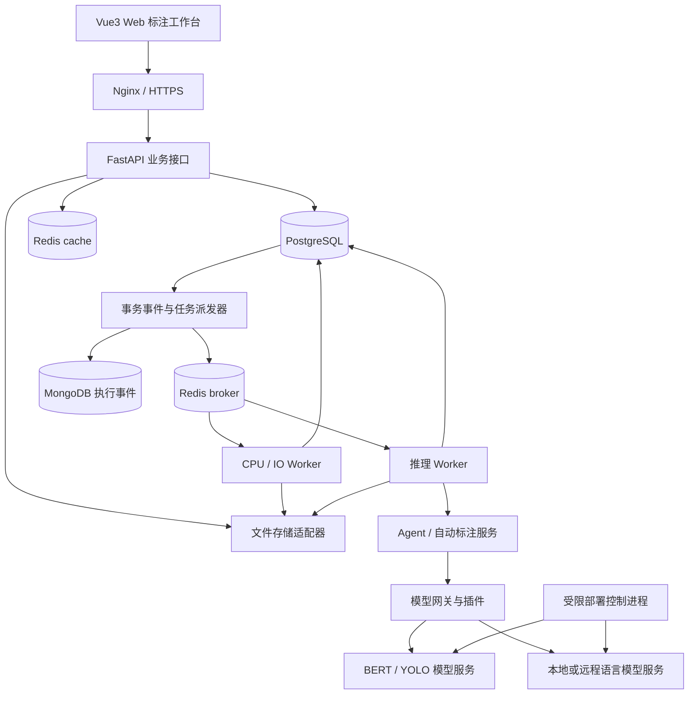
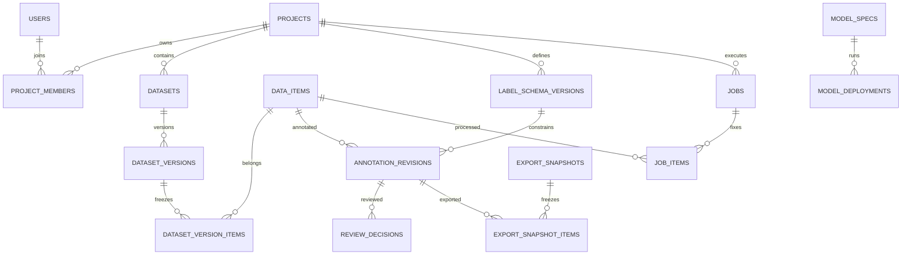
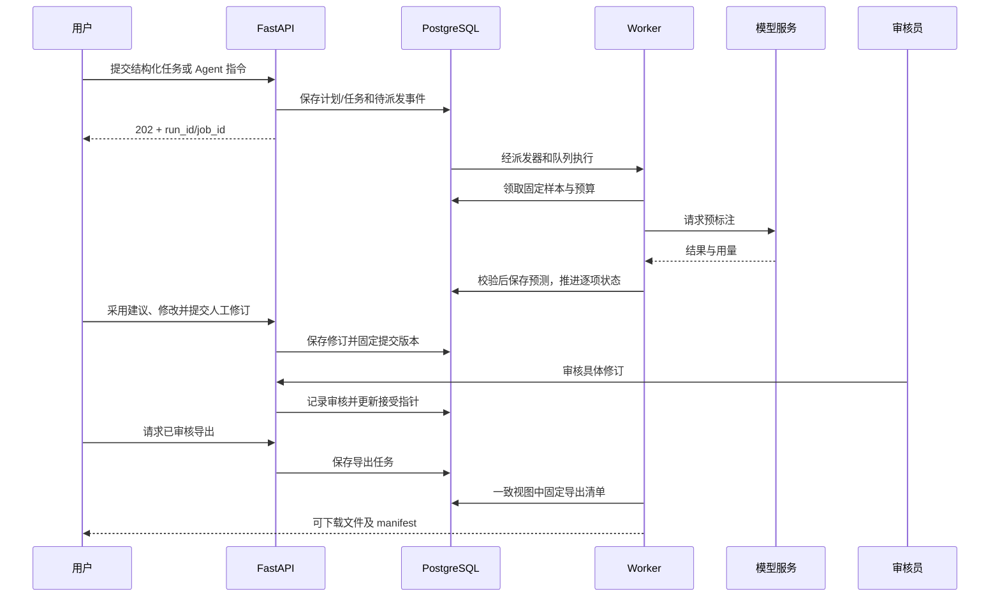

# 智能标注系统详细设计与实现方案

文档版本：1.0  
编写日期：2026-10-29  
适用项目：研究生毕业设计——智能标注系统  
文档性质：开发设计与验收依据；本文的接口、代码片段和配置属于待实现约定，不表示应用已实现或运行通过。

## 阅读导航

1. [目标、边界与关键决策](#1-目标边界与关键决策)
2. [架构与技术选型](#2-架构与技术选型)
3. [模块总览与依赖](#3-模块总览与依赖)
4. [前端工程设计](#4-前端工程设计)
5. [业务模块详细设计](#5-业务模块详细设计)
6. [数据库详细设计](#6-数据库详细设计)
7. [接口规范与示例](#7-接口规范与示例)
8. [关键流程与一致性](#8-关键流程与一致性)
9. [工程目录与配置](#9-工程目录与配置)
10. [部署运维与恢复](#10-部署运维与恢复)
11. [测试与验收](#11-测试与验收)
12. [实施计划与论文支撑](#12-实施计划与论文支撑)
13. [技术参考资料](#13-技术参考资料)

## 1. 目标、边界与关键决策

### 1.1 用户需求与当前条件

- 使用 Vue3 构建 Web 前端，使用 Python FastAPI 构建后端。
- 文本和图像同等重要，第一版任务为单标签文本分类、图像二维目标框检测。
- 支持用户身份、项目权限、Redis 缓存、关系型与非关系型数据库。
- 用户用自然语言表达标注要求，后端 Agent 将其转换成可执行任务。
- 管理员配置大模型服务，支持本地与远程模型适配。
- 模型可插拔，支持 BERT、YOLO、Qwen 和适当的 DeepSeek 蒸馏模型。
- 可通过受支持的配置一键启动模型服务，支持任务进度、错误定位和重试。
- 使用公开数据集；实验室 GPU 型号、数量和配额尚未确定。
- 当前主线为完整工程，后续以系统数据支撑质量改进与论文实验。

### 1.2 功能范围

| 范围 | 内容 |
| --- | --- |
| 基础必做 | 登录、项目、成员、标签规范、文本/图片导入、两类人工标注、审核、版本、导出 |
| 智能化必做 | 异步预标注、一个编排 Agent、API 配置、插件注册、基础质量路由、运行记录 |
| 工程完善 | PostgreSQL + MongoDB、Redis、任务恢复、部署模板、权限测试、备份与恢复 |
| 后续扩展 | 模型训练、反馈策略优化、实体识别、多标签分类、分割、视频、客户端采集 |

“后续扩展”仍规定接口边界，但不作为基本标注流程的前置条件。大模型不可用时，人工标注和审核流程仍可使用。

### 1.3 第一版的明确约定

1. 一个项目只使用一种任务类型；用户可创建多个文本和图像项目。
2. 预标注、人工修订、审核结论分开保存，模型不能覆盖人工审核成果。
3. 数据版本、标签规范版本、模型配置版本和导出快照均可追溯。
4. PostgreSQL 保存业务事实；MongoDB 保存辅助执行事件；Redis 不能成为最终标注的唯一副本。
5. HTTP 请求只做短事务；导入、批量推理、导出、训练和部署进入后台任务。
6. 一个 Agent 负责编排，确定性业务代码负责权限、预算、质量检查和写入。
7. 文本概率、检测分数、大模型自报把握不能直接按同一阈值比较。
8. 一键部署针对测试过的模型模板；加载模型和微调训练是独立操作。
9. 缺少标签解释、类别映射等必要信息时，返回明确待补充信息，不能猜测执行。
10. 所有数值上限与性能目标均为开发初始配置或测试目标，实际以部署测量为准。

### 1.4 术语与数据状态

| 术语 | 定义 |
| --- | --- |
| 数据项 Item | 一条不可变文本或一张规范化图片的记录 |
| 数据版本 | 项目数据项的固定集合与划分；发布后不在原版本中追加样本 |
| 标签规范 Schema | 标签 ID、说明、规则、示例及结果约束的固定版本 |
| 预测修订 Prediction | 模型输出，经格式校验后存储，尚未成为人工确认结果 |
| 人工修订 Human Revision | 用户编辑后的不可变结果；草稿与提交状态由工作状态记录 |
| 审核结果 | 对某个具体修订的接受或退回决定 |
| 工作状态 Work State | 当前草稿/提交/审核指针及并发版本，不是原始数据本身 |
| 导出快照 | 固定数据项、规范和修订 ID 的清单 |
| 模型规格 / 部署 | 不可变的检查点及推理配置 / 某次运行实例 |

## 2. 架构与技术选型

### 2.1 总体架构

采用模块化单体后端、独立 Worker 和模型服务，模块通过应用服务或明确协议调用。



推理 Worker 调用模型服务，并不意味着每个 Worker 都加载一份 GPU 模型。模型服务按部署实例管理权重与显存；Worker 管理业务批次和请求。

### 2.2 技术栈与实现选择

| 层 | 选型 | 实现说明 |
| --- | --- | --- |
| 前端 | Vue3 + TypeScript + Vite | Composition API；锁文件固定实际版本 |
| 页面与状态 | Vue Router、Pinia、Element Plus | 路由元数据声明展示权限，API 实施最终授权 |
| 图像编辑 | Konva + Vue 集成 | 图片层、框层、交互层；存原图坐标 |
| HTTP | 封装 fetch 或一个统一客户端 | 认证、错误、取消、刷新凭证集中处理 |
| 后端 | FastAPI + Pydantic | 类型化请求、响应和跨模块协议 |
| ORM | SQLAlchemy + Alembic | API 使用 AsyncSession；Worker 独立同步 Session |
| 关系库 | PostgreSQL | 关系约束、事务、JSONB 结果和版本指针 |
| 文档库 | MongoDB + PyMongo | 事件写入 Worker 用同步客户端，API 读取用其受支持的异步接口 |
| 长任务 | Celery + Redis broker | 队列分离、幂等、重试；DB 为任务状态权威来源 |
| 缓存 | 独立 Redis cache | TTL、推理缓存和临时交互信息 |
| 文件 | LocalStorageAdapter，后续 S3StorageAdapter | 业务保存对象键，不写死绝对路径 |
| 模型 | Transformers / PyTorch、Ultralytics、HTTP 适配器 | 每个模型服务固定自己的兼容依赖 |
| 本地 LLM | 支持目标检查点的运行后端；GPU 条件合适时使用 vLLM | 接口统一，运行后端可替换 |
| 运维 | Docker Compose、Nginx、结构化日志 | 开发与 Linux GPU 部署配置分开 |
| 验证 | pytest、前端单元测试、Playwright | 重点验证权限、坐标、版本和任务恢复 |

PostgreSQL 的 JSONB 支持索引，适合存任务相关结果，但项目关系、状态和权限仍使用明确字段与外键。[PostgreSQL JSON 类型文档](https://www.postgresql.org/docs/17/datatype-json.html)

### 2.3 层次职责

```text
Router / Dependency：请求解析、认证上下文、响应
Application Service：业务用例、授权、事务边界
Domain / Validator：状态转换、标签和结果校验
Repository：查询、锁、版本检查、持久化
Gateway / Adapter：模型、对象存储、队列、文档库
Worker：长任务领取、执行、恢复和结果汇总
```

Router 不直接调用 GPU，不拼接多表业务写入。Repository 不决定用户是否可操作。Worker 和 API 复用领域校验与应用服务，避免形成两套规则。

## 3. 模块总览与依赖

| ID | 模块 | 主要功能 | 主要依赖 |
| --- | --- | --- | --- |
| M01 | 身份与会话 | 登录、刷新、退出、禁用用户 | PostgreSQL |
| M02 | 项目与权限 | 项目、成员、角色、项目授权 | M01 |
| M03 | 数据集与导入 | 上传、解析、校验、去重、版本 | M02、M15、M18 |
| M04 | 标签规范 | 标签、规则、示例、发布与版本 | M02 |
| M05 | 任务分配 | 领取样本、租约、工作列表 | M02、M03、M08 |
| M06 | 文本标注 | 类别选择、草稿、快捷键、提交 | M04、M08 |
| M07 | 图像标注 | 框编辑、坐标转换、漏检补充 | M04、M08、M18 |
| M08 | 修订与版本 | 不可变结果、并发控制、来源 | M03、M04 |
| M09 | 质量审核 | 接受、退回、修正、抽检 | M08、M11 |
| M10 | Agent 编排 | 指令解析、计划、工具、总结 | M02、M04、M11、M13、M15 |
| M11 | 自动标注与质量路由 | 批量预测、格式校验、复核分流 | M08、M12、M15、M17 |
| M12 | 模型插件网关 | 能力协议、类别映射、预测调用 | M13、M14 |
| M13 | 大模型 API 与预算 | 配置、密钥、限流、额度和用量 | M01、M16 |
| M14 | 模型部署 | 模板、启动停止、健康、资源 | M12、M15、M21 |
| M15 | 后台任务 | 派发、执行、重试、取消、恢复 | M16、Redis broker |
| M16 | 持久化与事件 | PostgreSQL、MongoDB、事务事件 | 基础设施 |
| M17 | Redis 缓存 | 推理缓存、TTL、短期信息 | M12 |
| M18 | 文件与导出 | 受控文件访问、快照、格式转换 | M02、M08、M09、M15 |
| M19 | 训练与评估 | 数据划分、训练、模型评估 | M12、M14、M18 |
| M20 | 可观测与审计 | 请求日志、指标、审计、错误 | 所有模块 |
| M21 | 部署与运维 | 环境、迁移、备份、健康检查 | 基础设施 |
| M22 | 客户端采集扩展 | 来源、批量上传、断点与去重 | M01、M03、M18 |

这些是逻辑模块，不等于 22 个微服务。初期共用一个后端代码仓库和数据库，通过目录与应用服务划分边界。

第一版角色能力默认如下；管理员拥有全部管理能力但仍遵循修订和审核状态规则，owner 不默认绕过审核分工。

| 能力 | owner | annotator | reviewer |
| --- | --- | --- | --- |
| 读取本项目数据与历史 | 是 | 是 | 是 |
| 项目、成员、规范、导入管理 | 是 | 否 | 否 |
| 领取与编辑标注 | 是 | 是 | 仅审核修正 |
| 普通接受/退回审核 | 需同时授予 reviewer 能力 | 否 | 是 |
| 启动 Agent 与自动标注 | 是 | 默认否，可显式授予 | 默认否 |
| 导出训练数据、配置预算 | 是 | 默认否 | 默认否 |
| 全局 API 密钥、部署、用户管理 | 否 | 否 | 否 |

## 4. 前端工程设计

### 4.1 页面与路由

| 路由 | 页面 | 实现重点 |
| --- | --- | --- |
| /login | 登录 | 表单校验、通用失败信息 |
| /projects | 项目列表 | 搜索、分页、新建、归档 |
| /projects/:id/overview | 项目概览 | 数据量、审核量、失败任务 |
| /projects/:id/members | 成员 | 项目负责人和管理员可操作 |
| /projects/:id/schema | 标签规范 | 草稿编辑、版本对比、发布 |
| /projects/:id/data | 数据列表 | 数据版本、类别、工作状态筛选 |
| /projects/:id/imports | 导入 | 上传、字段映射、错误报告 |
| /projects/:id/annotate/:itemId | 标注工作台 | 按项目任务类型装载文本/图像组件 |
| /projects/:id/review | 审核 | 待审核修订、差异、接受/退回 |
| /projects/:id/agent | Agent | 指令、计划、缺失字段、任务进度 |
| /projects/:id/jobs | 任务 | 状态、逐项错误、取消和重试 |
| /projects/:id/exports | 导出 | 快照范围、格式、下载 |
| /models | 模型 | 能力、配置版本、可用部署 |
| /admin/providers | API 配置 | 密钥写入、能力测试、预算 |
| /admin/deployments | 部署 | 模板、启动、停止、健康日志 |

### 4.2 状态与组件

- authStore：用户和内存中的访问凭证；刷新凭证由 HttpOnly Cookie 管理。
- projectStore：当前项目与展示权限；切换项目清理旧的上下文。
- annotationStore：当前 item、规范、工作版本、待保存内容、撤销栈。
- jobStore：当前观察的任务及轮询计时器；离开页面取消轮询。
- 大列表、图片二进制和所有历史修订不集中塞进 Pinia，按页面分页获取。

共享组件：ProjectHeader、LabelPalette、ItemNavigator、PredictionPanel、RevisionHistory、ReviewActions、JobProgress、ImportWizard、ModelSelector、ErrorDetails。

图像组件：ImageStage、BoundingBoxLayer、TransformerOverlay、ZoomToolbar。文本组件：TextViewer、SingleLabelEditor、RuleExamples。

### 4.3 请求、保存与冲突

1. API 客户端附加 Bearer token 和 request_id，解析统一错误结构。
2. 401 触发一次刷新；多请求共享刷新 Promise，避免并发旋转刷新凭证。
3. PATCH/POST 保存修订附带 expected_work_version 与客户端 operation_id。
4. 初始草稿自动保存可设为停止编辑 1 秒后触发；同一 item 的保存串行化。
5. 未完成请求时继续编辑，需要保留后续变更，不能用旧响应覆盖新草稿。
6. 409 冲突展示服务器版本与本地内容，由用户选择重新编辑或保留副本。
7. 网络失败保留内存草稿并显示未保存；默认不把项目原文存进浏览器持久化存储。
8. 切换样本前完成保存或明确保留未保存状态；快捷键在输入框内不触发标签操作。

### 4.4 图像坐标与编辑

后端结果统一使用原图像素坐标 xyxy，原点为左上角。规范化图片先处理 EXIF 方向；画布显示、模型输入和标签坐标都对应同一个规范化对象。

若画布缩放为 s、图片显示偏移为 (ox, oy)：

```text
image_x = (canvas_x - ox) / s
image_y = (canvas_y - oy) / s
canvas_x = image_x * s + ox
canvas_y = image_y * s + oy
```

有平移、嵌套变换时使用画布变换矩阵的逆变换，不再重复手工除缩放。模型服务如果返回已还原到原图的框，也不能再次反算 letterbox。

图像编辑顺序：鼠标按下记录起点 → 移动显示临时框 → 抬起归一化 x1/x2 和 y1/y2 → 裁剪到合法边界 → 选择类别 → 写入本地草稿 → 异步保存。

Konva Transformer 改变的是节点 scaleX/scaleY，而不是直接修改宽高；transformend 时应将缩放折算回原图框，再重置节点缩放。第一版关闭旋转和翻转。[Konva Transformer 文档](https://konvajs.org/docs/select_and_transform/Basic_demo.html)

图片列表使用缩略图，工作台加载原图，预加载下一张后限制缓存数量。撤销栈只记录语义操作，不记录图片二进制和整棵画布对象。

## 5. 业务模块详细设计

### M01 身份与会话

**功能：**登录、获取当前用户、刷新会话、退出、修改密码、管理员创建与禁用用户。第一版关闭公开注册。

**实现：**使用 Argon2 密码哈希、短期 JWT access token、随机 refresh token。刷新 token 只存哈希，放入 HttpOnly Cookie；正式部署配置 Secure、SameSite 和有限路径。access token 保存在前端内存，建议初始有效期 15 分钟，refresh 会话初始有效期 7 天，均可配置。

FastAPI 官方安全示例使用密码哈希和 JWT，并推荐 Argon2；本项目的刷新、退出与项目权限在应用层扩展。[FastAPI 安全文档](https://fastapi.tiangolo.com/tutorial/security/oauth2-jwt/)

JWT 校验签名、固定允许算法、issuer、audience、exp。每次业务请求读取用户 enabled 状态和 token_version。修改密码、禁用或全会话退出时递增 token_version 并撤销 refresh 会话。

刷新流程使用事务锁定会话，核验哈希与有效期，撤销旧 refresh 并生成新 refresh。检测重复使用时撤销该会话族。前端跨标签页刷新通过浏览器协调；不能为了兼容并发无限接受旧 refresh。

Cookie 刷新、退出端点检查 Origin 并采用 CSRF 保护；业务 Bearer 接口同样限制正式环境的 CORS 来源。登录失败统一返回账号或密码错误；账号/IP 限流不可影响其他用户正常会话。

**数据与接口：**users、refresh_sessions；POST /auth/login、/auth/refresh、/auth/logout，GET /auth/me。

**异常与验收：**失效凭证返回 401；权限不足返回 403；禁用用户现有 token 立即失去业务权限；退出后 refresh 不可继续使用；数据库与日志中无明文密码或 token。

### M02 项目与权限

**功能：**创建文本/图像项目、项目描述、归档、成员邀请或添加、角色调整、项目配置。

**实现：**全局管理员与项目成员角色分开建模。项目 owner、annotator、reviewer 各有明确操作集合。第一版 owner 负责项目管理，审核权限作为明确能力配置，不自动等同于任意角色。

所有 item、revision、job、file 查询先从数据库解析 project_id，再校验成员关系；不能仅相信请求体中的 project_id。列表查询在数据库中按权限过滤，分页统计同样过滤。后台任务保存 actor_id，派发和每批执行前校验用户和项目状态。

归档项目进入只读状态，不删除数据、历史规范或导出记录。跨项目文件内容可去重，但对象访问仍通过各项目授权，不能因摘要一致而泄露其他项目数据。

**数据与接口：**projects、project_members；/projects、/projects/{id}/members、/projects/{id}/archive。

**异常与验收：**非成员查询资源返回统一 404；已授权但操作能力不足返回 403。成员移除后不能下载原图或任务结果；全局管理员操作也留下审计记录。

### M03 数据集与导入

**功能：**CSV/JSONL 文本、图片包与可选 YOLO/COCO 标签导入；字段映射；去重；错误报告；数据版本和数据划分。

**实现流程：**

1. 创建 upload_session，通过受控路径上传到临时存储，确认 size 和 SHA-256。
2. UI 预览前若干条，选择文本字段、外部 ID、来源字段及标签用途。
3. 创建 import job，冻结解析配置、目标项目和规范版本。
4. Worker 流式解析、逐项校验，图片解码与方向规范化，保存尺寸和缩略图。
5. 保存 staging 数据版本与有效条目；错误逐项记录行号/文件名和原因。
6. 无错误时发布 ready 数据版本；有错误时进入 needs_resolution，由用户选择发布有效条目或取消。
7. 发布后固定数据集合。下一次导入形成新版本，可通过基于已有版本的合并形成新的完整集合。

去重配置可选 external_id 或规范化内容摘要；在当前目标集合内去重，保留导入报告，不默认跨版本删除有效记录。文本文档原文不随意 strip/改写；摘要和预处理规则保存版本。

公开真值导入必须选择 evaluation 或 editable_seed 用途。evaluation 数据写到隔离的参考标签表，不进入普通预测上下文；editable_seed 数据成为带来源的外部预标注，仍需要审核。

初始上传限制建议每个包 200 MB、单图片 20 MB、展开文件数 10,000，均可配置且后续测量调整。校验解压后总字节、压缩比例、路径穿越、符号链接和图片像素量。MIME 只是初筛，实际解析仍需校验文件内容。

**数据与接口：**upload_sessions、datasets、dataset_versions、dataset_version_items、data_items、import_errors、reference_annotations；/uploads、/projects/{id}/imports。

**异常与验收：**损坏行/图片不阻止错误报告生成；系统错误不发布不完整版本；未知 COCO 类别需显式映射；导入真值不进入大模型输入；取消后临时文件按保留策略清理。

### M04 标签规范与版本

**功能：**标签集合、含义、颜色、快捷键、正反例、排他规则和模糊情况说明；草稿与发布；规范版本对比。

**实现：**标签使用稳定 UUID，显示名称和导出整数 ID 分开。草稿可编辑，发布为不可变版本；新标签或规则变化生成新版本。发布前校验标签非空、ID/名称唯一、项目任务一致、规则字段合法。

文本结果要求恰好一个有效 label_id；无法判断时标记 needs_clarification，不自动创造“其他”标签。图像结果要求合法框和类别；空标注需要 explicit_empty=true，表示用户已确认无目标。模型空输出只能作为预测。

每个工作任务和修订绑定 schema_version_id。升级规范默认创建新的工作空间状态；历史审核不自动迁移。迁移工具可以生成建议修订并重新审核，不静默重写历史标签。

**接口与数据：**label_schemas、label_schema_versions；创建草稿、发布、获取历史版本、版本差异。

**异常与验收：**发布后的规范修改返回冲突或创建新草稿；未知标签预测被拒绝；旧规范导出使用其自己的映射；删除标签不能破坏历史导出。

### M05 样本分配与领取

**功能：**待处理列表、按类别/状态筛选、领取下一条、释放、分配给标注员、减少重复工作。

**实现：**work_states 按 item_id + schema_version_id 唯一。领取操作以短事务使用行锁和 SKIP LOCKED，写 claim_user_id、claim_token、claim_expires_at。初始租约可设 5 分钟，活跃编辑续期，浏览器关闭后自动到期。

任务列表从数据版本成员关系查询，模型预测和人工状态独立展示。审核领取可采用单独 review lease。租约只是减少重复领取；真正防止冲突的是 expected_work_version。

**接口：**POST /projects/{id}/claims/next、POST /claims/{id}/renew、DELETE /claims/{id}；GET /items 支持筛选和游标分页。

**异常与验收：**无待处理项返回明确空结果；用户离线后可重新领取；两人保存同一工作版本只有一人成功；修改后审核资格按规则重新计算。

### M06 文本分类工作台

**功能：**原文显示、单标签选择、标签说明、模型建议、人工草稿、提交、历史对比和快捷键。

**实现：**原文以文本节点渲染，禁止把导入内容作为 HTML 执行。标签编辑状态使用 label_id。模型建议作为独立卡片显示模型版本、更新时间与分数含义；点击采用建议产生人工修订并保留来源。

POST 修订保存 content、base_revision_id、operation_id、expected_work_version。草稿保存不等于提交；提交固定具体 revision_id，并校验其仍是当前草稿。长文本滚动显示，模型截断信息显式记录在任务诊断中。

**依赖：**M04 规范、M08 修订、M09 审核；组件见第 4 节。

**异常与验收：**没有选择标签不能提交；自动保存失败仍保留本地编辑；预测更新不改变用户正在编辑的类别；快捷键和鼠标产生相同结果。

### M07 图像目标框工作台

**功能：**原图缩放和平移、画框、移动缩放、修改类别、删除、撤销重做、补漏检、确认无目标。

**实现：**画布节点与业务草稿分离；业务框为 object_id、label_id、x1、y1、x2、y2。拖动结束才保存一次语义操作，不在每个鼠标事件请求 API。非有限数、反向框和越界框由前后端校验。

统一约束为 0 <= x1 < x2 <= image_width，0 <= y1 < y2 <= image_height；后端拒绝非法框而不是悄悄修正。UI 在用户拖动中可裁剪边界，但保存前显示最终位置。EXIF 方向先在导入阶段规范化，原始文件与规范化图片分别记录。

检测模型输出的 NMS、缩放和类别映射信息保存在 model config。用户选择采用预测时复制为人工草稿，不能直接把预测标记为“已人工确认”。

**异常与验收：**50%、100%、200% 显示下保存和重载框一致；缩放/平移后画框无偏移；空预测仍可补框；真无目标须明确确认；导出再导入坐标误差满足第 11 节要求。

### M08 标注修订与并发控制

**功能：**结果历史、来源追踪、模型/人工分离、乐观并发、撤销来源和导出引用。

**实现：**annotation_revisions 只追加，不 UPDATE content。保存时：

1. 授权并校验结果符合对应 item 与规范。
2. 先检查已完成 operation_id：同一授权操作和请求摘要直接返回原结果，内容不同返回 409。
3. 对尚未完成操作，以短事务锁定 work_state，复查 operation_id 并比较 expected_work_version，支持并发网络重发。
4. 新增不可变修订、更新当前草稿指针、递增 lock_version。
5. 如发生审核后编辑，清除当前 submitted/accepted 指针，标记重新审核；历史决定仍保留。
6. 提交事务后通过事件触发统计更新。

模型结果只新增 prediction revision 和 prediction link，不改人工草稿或 accepted 指针。每次真正重跑任务形成新 job；同一 job_item 的重投递不能创建第二份预测。

**异常与验收：**同一 operation_id 内容不同返回 409；并发版本冲突返回最新 work version；撤销通过新增修订实现；任何审核/导出均能找到完整来源。

### M09 审核与质量管理

**功能：**待审核列表、接受、退回、审核修正、模型与人工差异、随机抽检和项目质量概览。

**实现：**提交动作固定 submitted_revision_id；review_decision 针对 revision。先处理已成功的同 operation_id 请求，再在事务内核验该修订仍是当前提交版本，避免网络重发被误报为过期。第一版默认不允许标注者审核自己的修订，可由项目明确配置是否允许。

审核员修正时新增人工修订，再通过明确的“修正并接受”动作提交审核决定；界面记录审核编辑时间，不能只计算点击接受时间。退回需要原因码与可选备注。

基础版采用全人工审核后导出。后续允许机器自动通过时，保存独立 machine_decision 并显示与人工接受不同的状态，导出通过显式策略选择。分层随机抽检记录抽样种子、类别/风险区间和抽样概率，避免只用难例估计全量质量。

**数据：**review_decisions、review_tasks、sampling_runs；API 见第 7 节。

**异常与验收：**审核旧修订返回 409；已退回结果不能进入默认已审核导出；机器通过不冒充人工审核；审核日志可追溯人员、版本和时间。

### M10 Agent 编排

**功能：**理解自然语言要求、形成计划、识别缺失信息、调用受限工具、执行批量标注、总结结果。不是允许模型任意执行 Python 或 shell。

**内部结构：**InstructionParser、ContextBuilder、PlanValidator、ToolRegistry、Executor、RunRecorder。第一版不要求引入复杂 Agent 框架；用类型化状态机和 HTTP LLM Adapter 实现。未来接入框架时保留相同计划协议。

执行状态：received → planning → needs_input / validated → executing → completed / partially_failed / failed / cancelled。planning 可设置总超时与最大修复次数，例如 60 秒、最多 2 次格式修复，作为初始配置。

**流程：**

1. 后端根据当前用户解析项目、已发布规范、固定数据版本和允许的模型，不接受 LLM 自报的权限。
2. 将任务类型、规则与工具能力作为上下文；原始数据视作待标注内容，不成为工具权限指令。
3. 模型输出结构化计划，使用 Pydantic 校验，拒绝未知字段和未授权资源。
4. 指令与当前规范不一致时返回冲突说明；需要新增标签时先产生规范草稿，不边执行边改规范。
5. 样本范围通过后端查询生成固定 job_items，避免执行时范围漂移。
6. 自动执行已经授权的合法标注计划。UI 可查看或取消计划，但不强制每次增加确认步骤。
7. 工具通过应用服务执行；保存工具名、输入摘要、输出摘要、错误和耗时。
8. 总结必须基于数据库任务计数，不能采用模型编造的完成数量。

**计划结构示例：**

```json
{
  "task_type": "text_classification",
  "dataset_version_id": "<uuid>",
  "schema_version_id": "<uuid>",
  "selection": {"work_status": "unstarted", "limit": 500},
  "model_spec_id": "<uuid>",
  "review_policy": {"mode": "manual_all", "random_audit_rate": 0.05},
  "budget": {"currency": "CNY", "max_amount": "10.00"}
}
```

其中 project_id 和 actor_id 来自授权上下文；服务端预算只能收紧，不能被模型扩大。该示例为协议模板，尖括号字段替换成实际 UUID 后才能发送。

**工具边界：**read_items、get_schema、list_models、create_prediction_job、get_job_status、create_review_tasks、create_export。工具不向大模型返回 API key、数据库连接或评估真值。

**异常与验收：**模型返回无效 JSON、幻觉模型 ID、项目不匹配、标签冲突分别有错误码；信息不足进入 needs_input。超出修复次数停止规划，用户仍可通过结构化任务表单启动预标注。数据内容包含“忽略规则”时不能改变工具权限。

### M11 自动标注与质量路由

**功能：**选择样本、批量推理、格式与任务校验、缓存、保存预标注、创建复核项和统计质量信号。

**实现：**建立 AutoAnnotationService，按固定 job_items 分批处理：读取数据 → 缓存查询 → Gateway 预测 → SchemaValidator → TaskValidator → QualityRouter → 保存结果与审核任务。

基础策略支持 manual_all、score_threshold、score_threshold_with_audit。manual_all 为默认，机器建议必须经过人工。阈值由项目和具体模型规格配置，没有可靠分数的插件全部进入审核，不给默认 confidence=1。

文本风险：概率差距、熵、规则冲突、重复样本标签差异、输出有效性。初期先做可解释阈值与规则检查；反馈训练后再研究风险估计器。

图像风险：分类分数、定位稳定性、框边界异常、变换后目标数量差异、模型间不一致。没有框不能证明无目标；整图抽检独立于框分数。初期不实现多个复杂信号的全部组合，先保留字段并记录基线。

升级模型是明确的第二阶段动作；预处理、重复推理和升级模型成本全部计入预算。大小模型一致仅是一个信号，不代表真值。风险路由输出 reason_codes，UI 可解释为何进入复核。

**恢复：**格式错误最多有限修复；确定性类别/坐标错误不盲目重试。有效预测写入后 job_item 成功；审核等待不占用 Worker。批次返回不完整时分别处理成功与缺失条目。

**验收：**错误输出不能成为合法标签；模型失败不会改动人工结果；相同模型输入能命中缓存；规则变化失效；结果来源可追溯；完成计数与逐项状态相符。

### M12 模型插件与网关

**功能：**模型注册、能力发现、任务兼容校验、统一预测协议、类别映射、健康检查和错误转换。

**插件分层：**

- ModelAdapter：调用某种推理协议或运行库，例如 Transformers、Ultralytics、HTTP chat。
- ModelSpec：检查点、revision/hash、类别映射、模板、tokenizer、预处理、推理参数的不可变配置。
- ModelDeployment：某个 ModelSpec 的运行实例、endpoint、资源与状态。
- ModelGateway：选择可用实例、控制并发、调用 Adapter、统一结果和错误。

**必要能力：**metadata、validate_config、healthcheck、predict_batch。可选能力：train、evaluate。部署由 RuntimeManager 接口管理，远程 API Adapter 可以不支持本地部署。

协议代码示意：

```python
from typing import Literal, Protocol
from pydantic import BaseModel, ConfigDict, Field

class ClassificationResult(BaseModel):
    model_config = ConfigDict(extra="forbid")
    task_type: Literal["text_classification"]
    label_id: str
    score: float | None = Field(default=None, ge=0, le=1)
    score_kind: Literal["probability", "uncalibrated", "none"]

class Box(BaseModel):
    model_config = ConfigDict(extra="forbid")
    object_id: str
    label_id: str
    xyxy: tuple[float, float, float, float]
    score: float | None = Field(default=None, ge=0, le=1)

class DetectionResult(BaseModel):
    model_config = ConfigDict(extra="forbid")
    task_type: Literal["image_detection"]
    coordinate_space: Literal["original_image_pixels"]
    boxes: list[Box]

class ModelAdapter(Protocol):
    async def metadata(self) -> dict: ...
    async def validate_config(self, config: dict) -> None: ...
    async def healthcheck(self) -> dict: ...
    async def predict_batch(self, request: dict) -> dict: ...
```

这是协议结构示意，完整实现还需 UUID 类型、联合类型 discriminator、有限数检查、原图边界及标签校验。Pydantic 不能单凭以上字段自动检查某个标签是否属于项目规范，必须由 TaskValidator 结合数据库执行。

**BERT 插件：**使用任务分类检查点与 tokenizer，校验 id2label 和项目 label_id 映射；model.eval()、无梯度推理、批量 tokenization。记录 max_length、截断策略、截断样本数。未训练分类头不能宣传为可用分类模型。

**YOLO 插件：**模型服务独立加载权重，处理 RGB、模型要求的尺寸和批次；输出统一 xyxy、类别映射及 NMS 配置。优先使用库已经恢复至原图的结果，避免二次坐标转换。预训练类别不能直接用于任意自定义标签。

**LLM 插件：**固定模板包含规范和样本；要求仅返回合法标签/结果结构；每个 sample 有明确 ID。优先结构化响应，仍在后端校验。Qwen、DeepSeek 以检查点/供应商模型 ID 注册，不通过名字判断能力。文本模型不声明 vision 能力。

**版本与验收：**新配置创建新 ModelSpec，不原地改已有规格。模型健康失败不静默换成其他模型；显式 fallback 创建独立执行记录。新插件通过分类/检测合同样本、部分失败、超时、类别错配测试后可供项目选择。

### M13 管理员 API 配置、限流与预算

**功能：**模型服务配置、密钥轮换、连接测试、能力声明、项目授权、并发限制、额度预留与实际用量。

字段：provider_type、base_url、model_name、capabilities、secret_ref、timeout、max_concurrency、max_input_tokens、max_output_tokens、价格配置版本、项目范围和预算周期。兼容 HTTP 接口不保证所有供应商支持相同工具调用或结构化输出，连接测试需验证实际能力。

密钥通过服务端主密钥加密，记录 key_version；读取接口返回 has_secret 和掩码，不返回密文。主密钥不保存在数据库中。密钥轮换不修改历史记录中的供应商配置版本；日志按字段名单记录，避免只依靠正则掩码。

管理员 URL 配置支持本地模型地址，也必须限制允许目标与协议；禁止凭 URL 访问云元数据、其他管理接口或任意文件。用户只能选择已授权 provider，不能覆盖 base_url 或请求 header。

**预算事务：**

1. 在 PG 中锁定预算行，根据请求输入与 max_output_tokens 估计保守成本。
2. 检查 spent + reserved + new_reservation <= limit；创建唯一调用预留。
3. 提交事务后发起模型请求，事务锁不能覆盖外部请求时间。
4. 成功后记录供应商 usage 和价格版本，结算已预留额度。
5. 超时且供应商可能已执行时记 usage_unknown，暂保留预留，后续对账；不能直接假定未计费。
6. 供应商若不支持幂等调用，自动重试可能二次计费，重试同样需要额度并记录 attempt。

金额用 Decimal/NUMERIC，不用浮点；token、GPU 秒、人工秒分别记录。没有可信价格时以调用数/token 预算为硬约束，金额只作为未知或估算值。编排成本和标注成本都纳入任务汇总。

额度释放不是仅靠 TTL 删除 reservation：已调用但用量未知的预留进入对账状态。供应商重试身份、response_id 和实际 usage 尽量保留；没有供应商查询能力时保守计入估算并明确标记，不能把未知费用当零。

**验收：**并发请求不能同时占用同一剩余额度；超预算任务不给模型发请求；密钥不进入前端/日志/Agent；模型调用失败可定位到预留和 attempt。

### M14 模型部署与资源管理

**功能：**模板列表、下载/校验权重、启动停止、健康检查、资源状态、日志和失败重试。

**实现：**RuntimeManager 与 Adapter 分离。第一版支持预先运行的远程服务注册，以及通过受支持 Docker Compose 模板启动本地模型。管理员选择模板和白名单参数，部署控制进程调用 Docker SDK 或参数列表形式的命令，不拼接任意用户 shell。

API 和普通 Worker 不挂载 Docker socket；单独受限部署控制进程处理部署命令。该进程操作容器具有高权限，需要仅接受已校验的内部任务、固定镜像与固定挂载根目录。训练权重和下载路径通过对象键/模板解析，不接受任意宿主路径。

状态：requested → preparing → starting → warming → ready → draining → stopped；任何准备或启动失败转 failed。warming 包括加载和最小预测，不以进程启动成功作为可用判断。

停止时停止分配新请求，等待有界时间内的在途请求，再关闭服务。部署幂等键绑定 deployment_id，重复消息先核查实例，避免启动两个容器。回滚选择旧的健康部署，新 job 固定对应规格；旧 job 不被中途换模型。

GPU 配额管理以 GPU 编号、并发槽、保守显存配置和实际观测为依据。显存需求与上下文、批次、量化有关，资源检查不能保证不会 OOM。OOM 后停止本次 attempt；调整参数形成新配置版本或明确重新尝试，不无限重启。

对于 Linux GPU 运行环境和支持的模型，可通过 vLLM 的兼容 HTTP 服务接入；具体检查点与运行环境需要实际验证。[vLLM 服务文档](https://docs.vllm.ai/en/latest/serving/openai_compatible_server/)

**验收：**未知模板/越界参数被拒绝；健康失败部署不进入选择列表；停止不覆盖历史模型来源；不确定 GPU 时远程插件和人工流程可使用。

### M15 后台任务、队列与恢复

**功能：**导入、规划、推理、导出、部署、训练等任务派发，进度、逐项结果、取消、重试与恢复。

队列：io（导入导出）、planning（远程规划）、inference（推理业务请求）、deployment、training。第一版可合并轻量队列，但训练不和在线推理争同一个不受限的执行池。推理 Worker 的并发由模型容量和 provider 限流控制，不按 CPU 核心盲目启动。

**可靠派发：**API 事务新增 job、固定 job_items、outbox_event；事务提交后返回 202。派发器读取 outbox 发布 Celery 消息，成功后标记。发布成功但标记失败可能重复消息，Worker 必须幂等。Redis 丢失消息时，恢复器依据 DB 中长时间未领取任务重新派发。

任务状态：queued、running、cancel_requested、cancelled、succeeded、partially_failed、failed。结果只有明确完成的 job_items 才计成功。一般重試新建 retry job，保留 parent_job_id；同一 attempt 内的运输重投递不新增业务结果。

job_item 状态：pending、running、retry_wait、succeeded、failed、cancelled。领取使用 PG 短事务、租约、attempt_id 和 generation。外部调用期间周期续租，提交结果前核验 generation 仍有效，防止过期 Worker 回写。

Celery 的晚确认与重投递必须结合幂等设计；acks_late 不是“只执行一次”的保证。具体配置结合 Worker 被杀、broker 断开、Redis visibility timeout 和实际长任务测试确定。[Celery 任务文档](https://docs.celeryq.dev/en/v5.2.0/userguide/tasks.html)

**重试策略：**429 和暂时 5xx 使用 Retry-After 或有界指数退避 + 抖动；初始最大 3 次。认证错误、标签映射错、非法文件不重试。单批初始目标执行时间控制在几十秒内，耗时加载和训练单独管理；不是要求每个训练任务几十秒完成。

**取消：**批次边界和外部请求前检查 cancel_requested；取消后不领取新项，已提交结果保留。已在途请求可能完成且计费，记录其结果；禁止承诺点击取消即刻释放所有显存和费用。强制杀进程仅管理员诊断操作，并依赖恢复器识别中断任务。

**进度：**以 DB 聚合 done/total、成功、失败、取消数；缓存只加速展示。轮询初始 2 秒，后台标签页放慢，终态停止；有需要再添加带断线恢复游标的 SSE。

**验收：**API 重复提交、消息重复、Worker 中断、broker 重启、外部超时都有确定结果；DB 无重复预测；终态计数能从逐项记录重建。

### M16 PostgreSQL、MongoDB 与事务事件

**功能：**业务持久化、数据约束、JSON 结果、事件归档、迁移和双数据库协作。

PostgreSQL 保存权限、数据索引、版本、任务、审核、预算和导出。JSONB 用于结果与不可变配置，频繁筛选字段单独建列或明确索引。模型响应原文不无限写进 PG 大字段；保留必要结构和对象引用。

MongoDB 的 agent_events 保存 run_id、event_id、工具、状态、耗时和脱敏摘要。必要审计仍在 PG；MongoDB 故障不能让成功预测变成未知状态。通过 PG outbox 异步投递，Mongo event_id 建唯一索引，重复事件 upsert。

事件保留时间初始可设 90 天，论文实验批次显式标记保留。只有非必要诊断事件可配置 TTL；业务审核、模型配置和快照不可因日志 TTL 被清掉。MongoDB TTL 删除不是实时调度机制。[MongoDB TTL 文档](https://www.mongodb.com/docs/manual/tutorial/expire-data/)

采用 SQLAlchemy API AsyncSession 与 Worker 同步 Session，按请求/任务创建，不能把 AsyncSession 跨线程共享。Alembic 统一迁移。生产升级使用单独迁移 job，不让多个 API 副本启动时争相执行 DDL。

**验收：**PG 事务失败不发布相应任务；Mongo 停机期间继续保存核心结果；恢复后事件可补投；迁移和恢复在独立测试环境验证。

### M17 Redis 缓存与临时信息

**功能：**推理结果缓存、简单限流计数、临时 UI 进度和查询加速。预算、refresh 会话和正式工作租约由 PG 管理，防止缓存淘汰后失去约束。

实例隔离：redis-broker 使用 noeviction 与持久化，内存不足时发布失败进入告警和补投；redis-cache 可使用有界内存和 allkeys-lru。即便 broker 有持久化，仍保留 DB 恢复机制。[Redis 淘汰策略文档](https://redis.io/docs/latest/develop/reference/eviction/)

推理键：pred:v1:project_id:SHA256(canonical_input)。摘要输入包含内容、规范、模型规格、预处理、模板、随机参数与种子。文本拼接使用规范 JSON 序列化，不能仅用原文摘要；缓存结果包含实际来源和运行版本。

初始 TTL：预测结果 24 小时、查询概览 30 秒、UI 进度 10 秒，均可配置。预测缓存命中也新增当前 job_item 的来源链接并记实际调用成本为零、缓存来源为非零历史成本；不能把历史 usage 重复算作新费用。

缓存故障降级为 DB 查询或模型调用；必要的限流若不可用采用保守 DB/进程容量限制而不是完全放开。模型服务的并发槽不依赖会被 LRU 淘汰的缓存 key。

**验收：**改规则/参数不命中旧结果；不同项目不越权复用；清空 cache 不丢审核成果；broker 内存不足明确失败并可恢复。

### M18 文件存储、格式转换与导出

**功能：**临时上传、原始对象、规范化图片、缩略图、受控下载、快照导出和旧文件清理。

StorageAdapter 提供 put/open/stat/delete/presign，可使用 LocalStorageAdapter 和 S3StorageAdapter。PG 保存 object_key、SHA-256、大小、媒体类型与来源。Local 实现按配置根目录解析对象键，禁止 ../、绝对路径和符号链接绕过。

图片访问 API 校验项目后读取对象或签发短期受限 URL；不直接公开整个文件卷。签发 URL 是有限时访问凭证，用户移除后的已签发 URL 可能存活到过期，需在策略中使用短有效期或代理下载。

**导出流程：**授权并选择数据/规范版本 → 固定修订清单 → 创建 export job → Worker 校验与转换 → 写临时文件并计算摘要 → 标记 ready → 受控下载。快照必须在同一 DB 一致视图中形成，可采用短期 REPEATABLE READ 事务；大规模快照在后台创建，API 只提交请求。

| 格式 | 第一版输出 |
| --- | --- |
| 文本 JSONL | sample_id、text、label_id、label_name、revision_id |
| 文本 CSV | 同上并正确转义；供表格查看时提供公式安全选项 |
| 图像 YOLO | images/、labels/、data.yaml、label_map.json、manifest.json |
| 图像 COCO | images、annotations、categories，以及版本清单 |

内部 xyxy 转换：COCO 为 [x1, y1, x2-x1, y2-y1]；YOLO 为类别整数、中心 x/W、中心 y/H、宽/W、高/H。YOLO 整数 ID 从 0 开始，与内部 UUID 明确映射；COCO 类别 ID 不假定连续。[Ultralytics 格式说明](https://docs.ultralytics.com/guides/coco-to-yolo/)

YOLO 输出至少 8 位小数；COCO 保存原图像素数值。确认无目标图片输出空标签文件，并在 manifest 中保存 explicit_empty。未知类别、非法框或过期审核不能静默跳过，生成失败报告。

manifest 包含数据和规范版本、每个文件摘要、修订 ID、模型来源、创建时间、split 和标签映射。导出不包含密钥、refresh token 或无必要用户隐私。

**验收：**导出期间发生编辑不改变快照；完整重导入能恢复标签和框；权限不足不能下载；未完成临时导出不能作为 ready 文件访问。

### M19 训练与评估（扩展模块，先保留数据）

**功能：**固定数据快照、train/val/test 划分、训练任务、指标、模型候选发布和实验对比。

实现：训练任务引用不可变 export/dataset snapshot，固定标签映射、随机种子、超参数、检查点和代码版本。text 训练分类头，image 训练检测器；训练产生新的 ModelSpec，不替换旧规格内容。

API 输入只允许注册训练配方和参数。训练使用独立队列与资源槽，日志包含 epoch、loss、验证指标和资源用量；中断保存可恢复检查点，但需验证运行环境与数据版本一致。生成模型先处于 candidate，评估通过后由管理员/负责人发布。

参考标签仅由 EvaluationService 在授权评估任务内读取；planning、推理与普通训练任务不能读取测试真值。根据设备/来源/拍摄批次分组划分，避免重复图片或相似文本跨集合泄漏。

指标：文本 Accuracy、Macro-F1、各类混淆；检测 mAP、召回、误检、漏检及定位误差；系统吞吐、延迟、GPU 时间、调用成本、人工活动时长。人工时间记录活跃编辑区间，空闲超时暂停；不要把整个浏览器打开时间算审核耗时。

前期保存预测、人工修正、原因码和随机抽检配置。后期比较仅小模型、仅升级模型、固定阈值、反馈策略，公平计入全部预测与反馈成本。工程完成不自动等于算法创新，方法贡献需单独证明。

### M20 日志、监控与审计

**功能：**request_id/run_id/job_id 链接、结构化错误、任务指标、审计查询、模型健康和资源告警。

每条日志记录 timestamp、level、service、request_id、project_id、job_id、attempt_id、error_code、duration_ms。默认不记录原文、图片内容、密钥、Cookie、Authorization 或完整模型请求。需要诊断样本时采用明确的受限对象引用和保留策略。

业务审计：登录会话变更、角色调整、规范发布、审核、导出、API 配置、模型部署、预算修改。PG 保存必要摘要，Mongo 保存工具执行事件；普通应用日志用于故障排查。

指标：队列等待、任务失败/重试、推理 P50/P95、provider 429/5xx、预算预留、outbox 积压、缓存命中、显存/OOM、磁盘容量、事件补投。request_id 不作为高基数监控 label，保留在日志中。

健康：/health/live 只检查进程；/health/ready 检查 PG 与所需配置。Mongo/模型服务可作为独立组件状态；某个模型失败不让人工标注 API 全部不可用。/metrics 仅内部访问。

**验收：**可从任务找到单项失败及模型 attempt；日志抽查无凭证；Mongo 不可用有积压指标；任务统计与 DB 可复算。

### M21 部署、配置与运维

**功能：**本地开发、Linux GPU 环境、数据库迁移、初始管理员、Compose、备份恢复与升级。

最小 CPU 环境：frontend/nginx、api、worker、dispatcher、postgres、redis-broker、redis-cache、存储卷。Mongo 在工程完善阶段加入；完成版默认启用。BERT/YOLO 可用小批 CPU 功能测试，但吞吐不作保证；本地 LLM 不成为 CPU 环境启动条件。

GPU 环境：额外 model services、GPU 运行配置和受限部署控制进程；具体镜像、驱动、量化与显存配额等硬件明确后验证。macOS 开发不直接照搬 Linux CUDA 容器。

环境变量、镜像版本、启动与迁移见第 9、10 节。初始管理员由管理命令创建，不提交固定密码。模型文件与数据卷不嵌入应用镜像。API、模型管理接口和数据库不直接暴露到公共网络。

**验收：**空环境迁移后可登录并完成两类流程；重启不丢数据；备份能恢复修订和文件；缺少非必要模型不阻塞人工标注；配置不足返回明确启动错误。

### M22 客户端采集（后续扩展）

**功能：**提交文本/图片、来源和采集时间、分块上传、断点重试、内容去重、同步状态。

客户端选择桌面或移动技术栈在后续确定，不影响服务端。复用 UploadSession 和 Import API；客户端使用受限设备凭证，不嵌入管理员 key。每个上传操作带 operation_id 与 SHA-256，重试返回已有结果。

来源字段包括 source_url、collector_id、collected_at、source_type、许可/用途备注；数据来源元信息与标注结果分开保存。第一版不开放任意服务器代抓 URL，避免把简单导入扩展为不可控采集服务。

服务端明确接收大小和展开限制，客户端显示 pending/uploading/importing/ready/failed。协议提供状态查询，客户端重启后可恢复而不重新上传全部对象。

## 6. 数据库详细设计

### 6.1 通用约定

- 主键 UUID；关联 ID 通过外键约束。可由应用生成 UUID，不能用模型返回 ID 直接入库。
- 时间 TIMESTAMPTZ，存储 UTC，前端按 Asia/Shanghai 显示。
- 金额 NUMERIC(18,6)、货币代码显式记录；文件字节、token 使用 BIGINT。
- 状态使用 VARCHAR + CHECK 或统一应用枚举；不可变配置和结果使用 JSONB。
- mutable 业务行包含 lock_version，created_at/updated_at；不可变修订包含 created_at。
- 跨项目引用由应用事务和必要的复合外键共同校验，单独存在的 UUID 不代表关联合法。
- 默认不对历史审核和快照做级联删除；项目归档采用只读状态。

### 6.2 核心数据表

以下为实现字段清单，工程实现时通过 SQLAlchemy Models 与 Alembic 生成完整 DDL；不是可直接执行的全部建表 SQL。

#### 身份与项目

| 表 | 核心字段 | 约束与索引 |
| --- | --- | --- |
| users | id、username、email、password_hash、enabled、is_admin、token_version、created_at | username 唯一；email 可空且非空唯一 |
| refresh_sessions | id、user_id、family_id、token_hash、expires_at、revoked_at、replaced_by、created_at | token_hash 唯一；(user_id, expires_at) |
| projects | id、name、task_type、description、status、created_by、active_schema_version_id、lock_version | task_type 合法；(created_by, status) |
| project_members | project_id、user_id、role、permissions_override、created_at | 联合主键；user_id 索引 |
| audit_logs | id、actor_id、project_id、action、target_type/id、summary_json、request_id、created_at | (project_id, created_at)、(actor_id, created_at) |

is_admin 是全局能力，role 是项目角色。permissions_override 初期可以不启用，避免角色与覆盖规则冲突；若启用以显式允许集并禁止越过全局限制。

#### 数据、对象与规范

| 表 | 核心字段 | 约束与索引 |
| --- | --- | --- |
| storage_objects | id、object_key、sha256、byte_size、media_type、kind、status、created_at | object_key 唯一；sha256 索引；byte_size >= 0 |
| upload_sessions | id、project_id、owner_id、object_id、expected_size/hash、status、expires_at | (owner_id, status)、expires_at |
| datasets | id、project_id、name、description、created_at | (project_id, name) |
| dataset_versions | id、dataset_id、project_id、version_no、base_version_id、status、config_json、created_at | (dataset_id, version_no) 唯一 |
| data_items | id、project_id、task_type、external_id、content_hash、text_content、image_object_id、original_object_id、width、height、metadata_json | (project_id, content_hash)、(project_id, external_id)；类型字段 CHECK |
| dataset_version_items | dataset_version_id、item_id、split、source_row、group_key | 联合主键；(dataset_version_id, split, item_id) |
| import_errors | id、job_id、source_row/path、error_code、message、details_json | (job_id, id) |
| label_schemas | id、project_id、name、created_at | project_id |
| label_schema_versions | id、schema_id、project_id、version_no、status、task_type、labels_json、rules_json、examples_json、config_hash | (schema_id, version_no) 唯一；发布后内容不可改 |
| reference_annotations | id、item_id、schema_version_id、split、content_json、source、dataset_version_id | (dataset_version_id, item_id, schema_version_id) 唯一 |

data_items 内容发布后不修改。一个数据项可属于多个数据版本，split 位于成员关系上而不是写死在 data_items 中。reference_annotations 通过独立评估访问服务和 DB 权限与普通预测隔离。

#### 工作状态、修订与审核

| 表 | 核心字段 | 约束与索引 |
| --- | --- | --- |
| work_states | id、project_id、item_id、schema_version_id、state、draft_revision_id、submitted_revision_id、accepted_revision_id、lock_version、claim_user_id/token/expires_at | (item_id, schema_version_id) 唯一；(project_id, schema_version_id, state) |
| annotation_revisions | id、project_id、item_id、schema_version_id、source_kind、actor_id、base_revision_id、content_json、content_hash、operation_id、job_item_id、model_spec_id、created_at | 人工 (actor_id, operation_id) 部分唯一；模型 job_item_id 部分唯一；(item_id, schema_version_id, created_at) |
| prediction_links | job_item_id、revision_id、cache_source_revision_id、quality_signals_json、reason_codes_json | job_item_id 唯一；revision_id 外键 |
| review_tasks | id、project_id、revision_id、source、status、assigned_user_id、claim_expires_at、sampling_run_id | (revision_id, source) 唯一；(project_id, status) |
| review_decisions | id、project_id、revision_id、reviewer_id、decision、reason_code、comment、operation_id、request_hash、created_at | (reviewer_id, operation_id) 唯一；(revision_id, created_at) |
| sampling_runs | id、project_id、snapshot/config_json、seed、strata_json、created_at | project_id；抽样配置不可变 |

work_states.state 为 unstarted、draft、submitted、accepted、returned。模型预测不推进人工 state。accepted_revision_id 表示当前工作版本的人工接受；历史接受与退回完整保存在 review_decisions 中。

如启用 machine 自动通过，再增加 machine_decisions（revision_id、policy_version、decision、signals、sampling_run_id），不复用 human review_decisions。人工修订的幂等请求摘要需覆盖 schema、item、base_revision 和完整 content；提交操作可用独立 work_operations 表保存 operation_id、request_hash 和响应，避免混同于草稿保存。

模型缓存命中时仍创建当前 job_item 对应的预测修订或明确的唯一预测链接；推荐第一版创建修订，记录 cache_source_revision_id，便于按任务独立追踪。

#### 模型、预算与部署

| 表 | 核心字段 | 约束与索引 |
| --- | --- | --- |
| provider_configs | id、name、type、base_url、model_name、capabilities_json、secret_id、config_version、status、timeout、limits_json | 不可变行为配置；状态可变；name/version 唯一 |
| provider_secrets | id、encrypted_value、key_version、rotated_at、enabled | API 不提供读取密文 |
| provider_project_grants | provider_config_id、project_id | 联合主键 |
| price_versions | id、provider_config_id、currency、input_rate、output_rate、unit、effective_from | 时间和版本明确；金额精确 |
| budget_accounts | id、project_id、provider_config_id、period_start/end、currency、limit_amount、spent、reserved、lock_version | 项目/provider/周期唯一；余额 CHECK |
| model_calls | id、job_item_id、agent_run_id、attempt_no、provider_config_id、price_version_id、status、reservation、actual_cost、usage_json、started_at/ended_at | 调用身份唯一；(provider_config_id, started_at) |
| model_specs | id、name、task_types_json、adapter_name、checkpoint_uri/revision/hash、provider_config_id、config_json、config_hash、status | config_hash 与版本引用；发布后内容不改 |
| model_deployments | id、model_spec_id、template_id、status、endpoint、resource_json、runtime_id、generation、heartbeat_at、last_error_json | runtime_id 非空唯一；(model_spec_id, status) |
| deployment_templates | id、name、version、image_ref、allowed_params_json、resource_defaults_json、enabled | (name, version) 唯一；受控发布 |

provider 密钥轮换可以更新 secret slot，行为变更（模型、URL、模板）创建配置版本；历史可追溯的是行为与价格，不保存可公开重放的旧密钥。供应商 model alias 本身可能变化，若无法固定实际版本，在任务来源中标记此限制。

#### 任务、导出与训练

| 表 | 核心字段 | 约束与索引 |
| --- | --- | --- |
| jobs | id、project_id、actor_id、type、status、parent_job_id、idempotency_scope、idempotency_key、request_hash、config_json、total/succeeded/failed/cancelled、generation、heartbeat_at、created_at | (actor_id, project_id, idempotency_scope, idempotency_key) 唯一；(status, created_at) |
| job_items | id、job_id、item_id、status、attempt_no、generation、lease_expires_at、result_revision_id、error_code/details、next_retry_at | (job_id, item_id) 唯一；(job_id, status)、lease_expires_at |
| job_attempts | id、job_item_id、generation、status、started_at/ended_at、error_json、model_call_id | (job_item_id, generation) 唯一 |
| agent_runs | id、project_id、actor_id、instruction、status、plan_json、schema_version_id、dataset_version_id、job_id、missing_fields_json、idempotency_key、request_hash、created_at | (actor_id, project_id, idempotency_key) 唯一；(project_id, created_at) |
| outbox_events | id、topic、aggregate_type/id、payload_json、status、attempt_count、next_retry_at、created_at | (status, next_retry_at) |
| export_snapshots | id、project_id、dataset_version_id、schema_version_id、policy_json、status、created_by、created_at | (project_id, created_at) |
| export_snapshot_items | snapshot_id、item_id、revision_id、split | (snapshot_id, item_id) 主键 |
| exports | id、snapshot_id、format、status、object_id、manifest_object_id、job_id、error_json | (snapshot_id, format) |
| training_runs | id、project_id、snapshot_id、recipe_version、config_json、job_id、status、metrics_json、output_model_spec_id | 扩展模块 |

对于没有 item 的导出/部署 job，不人为插入虚假 data_item；使用 jobs + 阶段日志跟踪，或另建 job_steps。job_items 仅代表实际样本工作。

全局部署 job 可没有 project_id，需对 project_id IS NULL 的任务增加独立的部分唯一索引，或采用非空 scope_id 标识全局范围。不能依赖含 NULL 的普通联合唯一约束实现全局幂等。

### 6.3 约束示例

```sql
-- 下面是约束片段，需在相应表创建后由迁移添加。
ALTER TABLE data_items ADD CONSTRAINT ck_item_payload CHECK (
  (task_type = 'text_classification'
    AND text_content IS NOT NULL AND image_object_id IS NULL)
  OR
  (task_type = 'image_detection'
    AND image_object_id IS NOT NULL AND text_content IS NULL
    AND width IS NOT NULL AND height IS NOT NULL
    AND width > 0 AND height > 0)
);

CREATE UNIQUE INDEX uq_model_revision_per_job_item
ON annotation_revisions(job_item_id)
WHERE job_item_id IS NOT NULL AND source_kind = 'model';

CREATE UNIQUE INDEX uq_human_revision_operation
ON annotation_revisions(actor_id, operation_id)
WHERE source_kind = 'human' AND operation_id IS NOT NULL;

ALTER TABLE budget_accounts ADD CONSTRAINT ck_budget_nonnegative
CHECK (limit_amount >= 0 AND spent >= 0 AND reserved >= 0);
```

budget 的 spent 可因供应商对账修正超过 limit，需要告警而非丢弃真实账单；额度预留时在事务内检查限额，不使用“任何时候 spent <= limit”的硬约束掩盖已产生费用。

### 6.4 ER 关系概览



### 6.5 MongoDB 文档协议

agent_events 文档示例，UUID 在实际存储中统一为字符串或 BSON UUID，不能混用：

```json
{
  "event_id": "evt-unique-id",
  "run_id": "<uuid>",
  "project_id": "<uuid>",
  "job_id": "<uuid>",
  "sequence": 12,
  "event_type": "tool_finished",
  "tool_name": "create_prediction_job",
  "status": "succeeded",
  "input_summary": {"item_count": 100},
  "output_summary": {"created_job_id": "<uuid>"},
  "duration_ms": 125,
  "created_at": "2026-10-29T06:00:00Z",
  "expire_at": "2027-01-27T06:00:00Z"
}
```

created_at/expire_at 实际写入 BSON Date。索引：event_id 唯一；(run_id, sequence)；(project_id, created_at)；expire_at 单字段 TTL。sequence 可有间断，显示顺序稳定且通过 event_id 去重；必要任务总结保存在 PG。

### 6.6 查询与性能原则

大列表使用游标 (created_at, id)，默认 limit=50、最大 200。概览统计可异步更新，但提供 DB 重建工具；计数更新使用幂等事件或事务，不因重复消息多加一次。按 JSON 内类别筛选需求出现后再建表达式/GIN 索引，不给所有 JSON 全量索引。

第一版先测 1,000 条文本和 100 张图片的功能，再按固定环境扩展 10k/100k 数据索引。模型吞吐与 API CRUD 性能分别报告，避免把模型下载时间当 API 延迟。

### 6.7 事件协议与模块调用

| topic | 产生模块 | 消费模块 | 关键字段与用途 |
| --- | --- | --- | --- |
| job.dispatch_requested | API / M15 | dispatcher | event_id、job_id、queue；可靠派发 |
| import.version_ready | M03 | 概览统计 | version_id、有效/错误计数；更新数据概览 |
| annotation.revision_created | M08 | 统计/审计 | revision_id、source、schema_version；来源统计 |
| annotation.submitted | M08 | M09 | revision_id、work_version；创建正式审核任务 |
| review.decided | M09 | 统计/反馈 | decision_id、revision_id、decision；质量统计 |
| agent.tool_finished | M10 | Mongo 归档 | event_id、run_id、sequence、摘要；执行记录 |
| model.deployment_changed | M14 | 网关可用性查询 | deployment_id、generation、status；刷新实例信息 |
| export.ready | M18 | 文件页/通知状态 | export_id、object_id、manifest_id；准备下载 |

事件 payload 使用版本字段 event_schema_version。默认只含 ID 与必要摘要，不复制密钥或原始数据；消费者按 event_id 幂等。同一个事件派发给多个消费者时，各消费者分别记录投递状态，不能一个消费者成功就把其他消费者的待办一起清掉。初期可为每个目标生成独立 outbox 记录，避免引入额外消息平台。

## 7. 接口规范与示例

### 7.1 HTTP 通用规范

前缀 /api/v1；JSON UTF-8；Bearer access token；文件请求使用 multipart 或 upload session。openapi.json 由 FastAPI 生成。成功响应直接返回类型化对象；错误统一结构。

| HTTP | 使用场景 |
| --- | --- |
| 200 | 获取、更新或重复幂等请求返回已有结果 |
| 201 | 创建短事务资源 |
| 202 | 长任务受理，不表示完成 |
| 204 | 成功退出或释放资源且无响应体 |
| 400 / 422 | 业务输入错误 / 字段类型校验错误 |
| 401 / 403 / 404 | 身份失效 / 授权不足 / 无资源或无可见权限 |
| 409 | 工作版本冲突、规范冲突、幂等键内容冲突 |
| 413 | 上传超过配置大小 |
| 429 | 用户/模型限流 |
| 503 | 必要组件不可用或模型当前不可用 |

```json
{
  "error": {
    "code": "REVISION_CONFLICT",
    "message": "当前标注已经更新，请加载最新版本。",
    "details": {"current_work_version": 8},
    "request_id": "req-unique-id"
  }
}
```

错误码至少包括 INVALID_CREDENTIALS、PROJECT_FORBIDDEN、SCHEMA_MISMATCH、INVALID_LABEL、INVALID_BOX、MODEL_UNAVAILABLE、PROVIDER_AUTH_FAILED、BUDGET_EXCEEDED、USAGE_UNKNOWN、IMPORT_INVALID、JOB_CANCELLED、REVISION_CONFLICT。对外响应不含 stack trace、SQL、文件根路径和供应商密钥。

### 7.2 接口清单与授权

| 接口 | 功能 | 授权 |
| --- | --- | --- |
| POST /auth/login、/auth/refresh、/auth/logout | 登录/刷新/退出 | 会话与 CSRF 策略 |
| GET /auth/me | 当前用户 | 登录 |
| GET/POST /admin/users | 用户管理 | 管理员 |
| GET/POST /projects | 列表/创建 | 登录；列表按成员过滤 |
| GET/PATCH /projects/{id} | 项目详情/编辑 | 成员 / owner |
| POST /projects/{id}/archive | 项目归档 | owner 或管理员 |
| GET/POST /projects/{id}/members | 成员列表/添加 | owner 或管理员 |
| PATCH/DELETE /projects/{id}/members/{user_id} | 角色/移除 | owner 或管理员 |
| GET/POST /projects/{id}/label-schemas | 规范/草稿 | 成员 / owner |
| POST /label-schema-versions/{id}/publish | 发布 | owner |
| POST /projects/{id}/uploads | 创建上传会话 | 项目数据管理能力 |
| PUT /uploads/{id}/content | 上传文件 | 创建者且项目授权仍有效 |
| POST /uploads/{id}/complete | 核验上传 | 同上 |
| POST /projects/{id}/imports | 受理导入 | owner 或管理员 |
| GET /projects/{id}/datasets、/dataset-versions | 版本列表 | 成员 |
| POST /dataset-versions/{id}/publish-valid-items | 接受有错误导入的有效部分 | owner |
| GET /projects/{id}/items | 分页数据 | 成员 |
| GET /items/{id}、/items/{id}/file | 数据详情/图片 | 成员 |
| POST /projects/{id}/claims/next | 领取样本 | annotator |
| POST /claims/{id}/renew、DELETE /claims/{id} | 续租/释放 | 领取者 |
| GET /items/{id}/revisions | 历史 | 成员 |
| POST /items/{id}/revisions | 保存人工草稿 | annotator；审核员修正能力另配 |
| POST /items/{id}/submit | 提交具体修订 | annotator |
| GET /projects/{id}/review-tasks | 审核列表 | reviewer |
| POST /revisions/{id}/reviews | 接受/退回 | reviewer |
| GET/POST /projects/{id}/agent-runs | Agent 列表/指令 | 项目启动任务能力 |
| POST /agent-runs/{id}/input | 补充缺失信息 | 创建者或 owner |
| POST /projects/{id}/prediction-jobs | 结构化自动标注 | 项目启动任务能力 |
| GET /projects/{id}/jobs、/jobs/{id}、/jobs/{id}/items | 任务查询 | 成员 |
| POST /jobs/{id}/cancel、/jobs/{id}/retry | 取消/重试 | 创建者或 owner |
| GET /models、/models/{id} | 插件和规格 | 根据模型授权过滤 |
| POST /admin/model-specs | 注册规格 | 管理员 |
| GET/POST /admin/provider-configs | API 配置 | 管理员 |
| POST /admin/provider-configs/{id}/test | 能力测试 | 管理员；计费调用记录 |
| POST /admin/provider-secrets/{id}/rotate | 密钥轮换 | 管理员 |
| GET/POST /admin/deployments | 查看/创建部署 | 管理员 |
| POST /admin/deployments/{id}/stop | 停止 | 管理员 |
| GET /projects/{id}/budgets、/usage | 预算与用量 | owner |
| POST /projects/{id}/exports | 创建快照导出 | owner 或已授予导出能力成员 |
| GET /exports/{id}、/exports/{id}/download | 状态/下载 | 相同导出授权 |
| POST /projects/{id}/training-runs | 训练 | 扩展；项目训练能力 |
| POST /projects/{id}/evaluations | 评估 | 扩展；受限评估能力 |

表中“能力”由固定角色映射定义，不能由客户端传入布尔值提升权限。管理员能力与项目能力在应用服务统一解析。

### 7.3 创建项目与发布规范

```json
{
  "name": "客服意图分类",
  "task_type": "text_classification",
  "description": "按主要诉求选择一个类别"
}
```

规范发布前请求示例：

```json
{
  "task_type": "text_classification",
  "labels": [
    {"id": "<label-uuid-1>", "name": "退款", "description": "主要请求退款", "color": "#5470C6"},
    {"id": "<label-uuid-2>", "name": "物流", "description": "查询物流或反馈配送问题", "color": "#91CC75"}
  ],
  "rules": {"single_label": true, "ambiguity_action": "needs_review"},
  "examples": [],
  "expected_version": 1
}
```

label ID 由应用创建，不能重复。只有退款/物流两类时，其他诉求不能凭空分成“其他”；应退回规范补充或标为需要澄清。

### 7.4 保存文本与图像修订

文本 POST /items/{id}/revisions：

```json
{
  "schema_version_id": "<uuid>",
  "expected_work_version": 7,
  "operation_id": "<client-operation-uuid>",
  "base_revision_id": "<uuid>",
  "content": {"task_type": "text_classification", "label_id": "<label-uuid>"}
}
```

响应：

```json
{
  "revision_id": "<uuid>",
  "work_version": 8,
  "work_status": "draft",
  "saved_at": "2026-10-29T06:00:00Z"
}
```

图像 content：

```json
{
  "task_type": "image_detection",
  "coordinate_space": "original_image_pixels",
  "explicit_empty": false,
  "boxes": [
    {"object_id": "<uuid>", "label_id": "<label-uuid>", "xyxy": [12.5, 20.0, 160.0, 210.0]}
  ]
}
```

图片尺寸通过数据库读取，不信任客户端自报 width/height。explicit_empty 与非空 boxes 不可同时成立；空 boxes 的人工提交要求 explicit_empty=true。

### 7.5 Agent 与结构化预标注

POST /projects/{id}/agent-runs，请求携带 Idempotency-Key：

```json
{
  "dataset_version_id": "<uuid>",
  "schema_version_id": "<uuid>",
  "instruction": "按当前规则标注未处理文本，不确定的进入审核。",
  "planning_provider_config_id": "<uuid>",
  "execution_limits": {"max_items": 500, "max_amount": "10.00", "currency": "CNY"}
}
```

立即返回 202、run_id、status=received。规划在 planning 队列执行；GET 查询可返回 needs_input 与 missing_fields。合法计划转为 job 后返回 job_id，不要求 HTTP 请求等到整批结束。

POST /projects/{id}/prediction-jobs 可以绕过自然语言规划，但不能绕过授权、规范、预算或结果校验：

```json
{
  "dataset_version_id": "<uuid>",
  "schema_version_id": "<uuid>",
  "model_spec_id": "<uuid>",
  "selection": {"work_status": "unstarted", "limit": 100},
  "review_policy": {"mode": "manual_all"}
}
```

job 状态响应：

```json
{
  "id": "<uuid>",
  "status": "running",
  "counts": {"total": 100, "succeeded": 60, "failed": 2, "cancelled": 0, "pending_or_running": 38},
  "usage": {"input_tokens": 12000, "output_tokens": 800, "cost": "1.200000", "currency": "CNY", "has_unknown_usage": false},
  "quality_queue": {"pending_annotation": 60, "pending_review": 0},
  "updated_at": "2026-10-29T06:00:00Z"
}
```

quality_queue 不参与计算任务终态。pending_annotation 表示机器建议尚未人工提交，pending_review 表示人工修订已提交等待审核；自动标注 succeeded 后两者都可非零。

### 7.6 审核与导出

POST /revisions/{id}/reviews：

```json
{
  "decision": "accept",
  "expected_work_version": 8,
  "operation_id": "<uuid>",
  "reason_code": null,
  "comment": null
}
```

接受前校验提交指针指向此 revision，且满足审核者权限。新建修订导致尚未执行的旧审核请求冲突；已成功请求的同 operation_id 重发返回原结果。

POST /projects/{id}/exports：

```json
{
  "dataset_version_id": "<uuid>",
  "schema_version_id": "<uuid>",
  "format": "yolo",
  "selection_policy": "human_accepted_only",
  "include_images": true,
  "splits": ["train", "val"],
  "filename_prefix": "annotation_export"
}
```

filename_prefix 限制字符与长度，不作为宿主路径；项目任务类型必须与格式兼容。快照形成后响应 snapshot_id 与 job_id，下载只有 ready 时可用。

### 7.7 幂等与版本 API 规则

- 创建长任务要求 Idempotency-Key，服务端存请求摘要；同 key 同内容返回已有 ID，同 key 不同内容返回 409。
- key 与用户、项目、接口类别绑定；不同用例不能意外共享同一键。
- 人工编辑与审核使用 operation_id + expected_work_version；重发成功操作返回原结果，即使工作状态后来改变，也不重复执行。
- 候选模型配置、规范发布和项目配置变更同样通过版本检查或 ETag 防覆盖。
- 长任务重试提供 parent_job_id，默认仅重试失败项，重新读取当前权限，但沿用原数据/规范/模型配置，不能无提示改任务含义。

## 8. 关键流程与一致性

### 8.1 文本自动标注到导出



### 8.2 事务边界

| 操作 | 原子范围 | 事务外操作 |
| --- | --- | --- |
| 提交后台任务 | job、固定项、outbox | 向 broker 发消息 |
| 领取工作样本 | claim、work version | 用户在浏览器编辑 |
| 保存人工修订 | 校验版本、修订、工作指针、审计 | UI 更新、事件派发 |
| 提交与接受审核 | 当前提交指针核验、决定、接受指针 | 后续导出 |
| 调用模型 | 领取租约、额度预留，各为短事务 | 模型网络请求 |
| 保存模型结果 | 有效 generation、唯一修订、状态、额度结算 | Mongo 事件归档 |
| 导出快照 | 一致版本集合、固定修订 | 读取图片、打包与上传 |

不用分布式事务同时包住 PostgreSQL、MongoDB、Redis 和对象存储。文件对象先写成功，再提交 ready 元数据；崩溃产生的无引用临时对象由清理任务回收。需要引用的文件验证完成前，数据版本不能发布为 ready。

旧 generation 的模型响应不能更新业务结果，但其真实调用用量仍应通过独立调用账本结算。账本以 model_call_id 幂等更新，不能因为 Worker 失去业务租约就丢弃已发生费用。

### 8.3 故障恢复表

| 故障点 | 现象 | 恢复方式 |
| --- | --- | --- |
| API 提交前断开 | 用户不知道是否创建 | 使用相同幂等键查询/重发 |
| PG 提交后 broker 发布失败 | queued 未执行 | outbox 重投与 DB 扫描 |
| 消息已发布但 outbox 未标记 | 重复投递 | 领取与结果唯一约束 |
| 模型已调用但 Worker 中断 | 成本可能已发生、结果未知 | attempt/usage_unknown，对账或受控重试 |
| 旧 Worker 租约过期后返回 | 与新 Worker 并发 | generation 检查拒绝旧结果，仍记调用费用 |
| MongoDB 暂时失败 | 辅助记录延迟 | PG outbox 积压后补投 |
| 导出打包中断 | 临时文件存在 | 依据快照重新生成，替换临时对象 |
| 用户保存时网络失败 | 不确定是否写入 | operation_id 重发，不重复修订 |
| 模型 OOM | 当前批次失败 | 停止 attempt，报告资源问题，显式调整新配置 |

### 8.4 审核、预测与工作状态的关系

预测候选可以生成待人工处理的质量任务，但不能直接由机器进入 human accepted 状态。基础流程为标注员采用/编辑预测 → 提交人工修订 → 审核员接受。

review_tasks 中的候选需区分 pending_annotation 与 pending_review。只有 submitted 人工修订可直接执行普通 accept。若后续提供审核员一键采用预测并接受，必须设计显式能力与完整人工修订操作记录，不能只把 source_kind=model 改成 human。

默认不允许审核自己的原始提交。审核员对他人提交执行“修正并接受”属于明确审核用例，保存原提交引用与审核修正来源，不允许通过该入口绕开原始提交者身份规则。

### 8.5 必须保持的不变量

1. 修订中的标签一定属于对应规范，图像框一定属于对应图片坐标空间。
2. 预测写入不推进人工审核状态。
3. 一份审核只对一个确定修订生效；编辑后需要重新审核。
4. 一个 job_item 在一次逻辑执行中最多产生一份有效结果。
5. 队列可重复投递，业务结果不能重复；外部模型调用仍可能重复并计费。
6. 导出文件内容来自固定清单，不来自打包时滚动读取的“最新结果”。
7. 权限在服务端验证；后台用户被移除后停止领取新的项目工作。
8. 测试真值不进入普通 Agent 与预测上下文。
9. 无框预测和人工确认无目标是不同状态。
10. 缓存清空不影响业务事实；辅助事件迟到不改变已有正确结果。

## 9. 工程目录与配置

### 9.1 建议目录

```text
futureproject/
  frontend/
    src/
      api/                  # HTTP 客户端、各域 API
      router/               # 页面路由与展示守卫
      stores/               # 身份、项目、标注与任务状态
      views/                # 项目、数据、工作台、审核、管理员
      components/
        annotation/text/
        annotation/image/
        shared/
      types/                # 由 OpenAPI 生成或校验的 TS 类型
      utils/                # 坐标转换、格式与键盘处理
    package.json
  backend/
    app/
      main.py
      api/v1/               # routers 和请求响应
      core/                 # settings、auth、permissions、errors
      db/                   # engine、sessions、migrations 辅助
      models/               # SQLAlchemy 模型
      schemas/              # Pydantic 请求响应和插件协议
      services/             # 项目、导入、修订、审核、预算、导出
      domain/               # 规范校验、状态机、质量策略
      repositories/         # 查询、版本检查与锁
      agent/                # parser、plan、tool registry、executor
      plugins/              # adapter registry 与模型网关
      storage/              # local 与 S3 适配器
      tasks/                # Celery tasks、dispatcher、recovery
      telemetry/            # 日志、审计、指标
      cli/                  # 管理员创建、诊断、统计重建
    alembic/
    pyproject.toml
  model_services/
    text_classifier/        # 独立依赖与模型镜像
    object_detector/
    llm/                    # 本地服务模板或接入说明
  deploy/
    compose.yaml
    compose.gpu.yaml
    nginx/
    model_templates/
    env.example
  scripts/                  # 导入样例、备份、恢复、演示准备
  tests/
    backend/
    plugin_contracts/
    frontend/
    e2e/
    fixtures/
  docs/
```

所有目录是规划结构，本文不表示这些应用文件已经生成。

### 9.2 服务配置项

| 配置 | 用途 | 初始约定 |
| --- | --- | --- |
| APP_ENV | development/test/production | production 严格校验 |
| DATABASE_URL / DATABASE_SYNC_URL | API 异步连接 / Worker 同步连接 | 采用同库不同驱动配置 |
| MONGODB_URI | 文档库 | 内网、受限账号 |
| REDIS_BROKER_URL / REDIS_CACHE_URL | 队列 / 缓存 | 两个独立实例 |
| JWT_SIGNING_KEY、JWT_ISSUER、JWT_AUDIENCE | 访问凭证 | 不提交到 Git |
| SECRET_ENCRYPTION_KEY / KEY_VERSION | 大模型密钥加密 | 挂载 secret，备份单独管理 |
| ACCESS_TOKEN_MINUTES / REFRESH_DAYS | 会话时长 | 初始 15 / 7 |
| CORS_ALLOWED_ORIGINS | 浏览器来源 | 列表，正式环境不为 * |
| STORAGE_BACKEND / STORAGE_ROOT | 文件存储 | local / 可写受控卷 |
| UPLOAD_MAX_BYTES / IMAGE_MAX_PIXELS | 上传与解码限制 | 按环境配置 |
| JOB_BATCH_SIZE | 业务批次 | 初始 16，按模型覆盖 |
| JOB_LEASE_SECONDS / HEARTBEAT_SECONDS | Worker 租约 | 初始 120 / 20，持续续租 |
| MAX_MODEL_CALL_SECONDS | 单次推理超时 | 按本地/远程分别配置 |
| MODEL_TEMPLATE_ROOT | 固定部署模板 | 只读挂载 |
| EVENT_RETENTION_DAYS | 非必要事件保留 | 初始 90；实验批次单独保留 |
| CACHE_TTL_SECONDS | 推理缓存 | 初始 86400 |
| LOG_LEVEL / LOG_FORMAT | 结构化日志 | INFO / JSON |

API 请求上下文、Agent 计划和模型配置只可覆盖允许参数。用户输入的预算不得超过项目预算，batch 不得超过模型服务上限。

### 9.3 开发规范

- Python 和 Node 使用与所选依赖兼容的受支持版本，落地时固定准确版本和锁文件。
- API 类型通过 OpenAPI 同步到前端，避免手写不一致 DTO。
- 数据库模型变化必须有迁移；不能靠删除数据库升级。
- Router、业务服务、Adapter 分层；模型运行代码不混进用户接口。
- 每个错误有稳定 code，中文 message 可以改进但客户端不按文案判断逻辑。
- 不提交数据包、模型权重、密钥、真实 Cookie、运行卷和临时导出。
- 分支合并前只运行与改动有关的有效验证，重大状态/协议改动覆盖合同与恢复场景。

## 10. 部署运维与恢复

### 10.1 环境分级

| 环境 | 用途 | 内容 |
| --- | --- | --- |
| 本机开发 | UI/API 开发 | 应用可本机运行，DB/Redis/Mongo 容器化 |
| CPU 演示 | 无 GPU 的流程验收 | 人工流程、远程 LLM、可选小批 CPU 模型 |
| Linux GPU | 本地模型与性能实验 | 独立模型服务、显存配额、训练队列 |
| 测试环境 | 回归与恢复 | 隔离账号、数据库、对象卷和模拟供应商 |

模拟供应商用于错误与恢复测试，界面明确标记模拟，不作为真实模型效果证据。

### 10.2 Compose 服务与启动

基础服务：nginx、api、worker-io、worker-planning、worker-inference、dispatcher、recovery、postgres、redis-broker、redis-cache、mongo。轻量 Worker 可在初期合并，保持队列名与迁移路径。

扩展服务：model-text、model-image、model-llm、deployment-controller、worker-training。按 profiles 启用。GPU 配置固定可见设备，不能让多个服务默认占满所有 GPU。

启动顺序：

1. 准备环境文件和 secret，确认数据库/对象卷位置。
2. 启动 PostgreSQL、Redis、MongoDB，等待健康。
3. 独立运行迁移命令，再通过 CLI 创建初始管理员。
4. 启动 API、派发与恢复进程、Worker、Nginx。
5. 注册可用模型规格与受支持部署，执行健康和最小预测。
6. 导入演示数据、创建规范，完成文本与图像验收。

规划中的命令入口为 `alembic upgrade head`、`python -m app.cli.create_admin`、`celery -A app.tasks.celery_app worker` 等；实际命令应在实现后写入运行 README 并测试，此处不声称已可直接执行。

### 10.3 备份、恢复与清理

备份包含 PG、文件对象、Mongo 必要事件、模板与配置版本，以及独立管理的加密主密钥。没有主密钥的 DB 备份不能恢复管理员 API 密钥；密钥备份不与公开数据包一起发布。

初始策略可为每日业务备份，重要实验前后快照。RPO/RTO 由实测确定，不承诺零丢失。恢复时停止写入或建立一致快照，校验 PG 引用对象存在、manifest 摘要正确、model specs 可解析，再恢复派发与业务。

清理顺序：过期未完成 upload、无引用临时导出、明确到期非必要事件。正式导出和历史修订只按明确保留策略归档；不能仅以“文件旧”删除仍被快照引用的数据。

### 10.4 升级与回滚

升级前备份，迁移设计为兼容当前/下一版应用的分阶段变化。先加列/新表和兼容读写，再迁移数据，最后删除旧字段。模型模板和规格固定版本，可回滚到旧部署；数据迁移不能仅通过回滚镜像恢复。

逐项恢复测试：API 重启、Worker 被杀、broker 重启、Mongo 离线、模型断开、对象文件缺失。现场演示至少准备已下载模型/远程备用配置和完整人工流程，避免临时下载成为演示依赖。

## 11. 测试与验收

### 11.1 模块验收矩阵

| 场景 | 输入/操作 | 预期 |
| --- | --- | --- |
| 身份与权限 | 非成员访问 item、文件、job | 无数据泄露；后端拒绝 |
| 会话旋转 | 同 refresh 重复使用 | 旧凭证不可继续刷新 |
| 数据导入 | 正常与损坏行、未知类别 | 错误逐项报告；发布策略明确 |
| 图片规范化 | EXIF 旋转、不同尺寸 | 显示/推理/标签使用相同坐标 |
| 文本编辑 | 网络失败、快捷键、自动保存 | 草稿不丢、不重复、不覆盖新编辑 |
| 图像编辑 | 缩放、平移、框移动、越界 | 保存原图坐标，非法结果拒绝 |
| 无目标 | 空预测与 explicit_empty | 不混为同一审核状态 |
| 并发保存 | 两个相同 work version | 仅一份成功，另一返回 409 |
| 审核 | 编辑后对旧 revision 接受 | 拒绝过期审核；历史保留 |
| 模型输出 | 非法 label、NaN、缺失样本 | 失败条目明确，不入合法结果 |
| Agent | 幻觉模型、项目不匹配、规则缺失 | 校验/needs_input，无越权执行 |
| 任务幂等 | API 重发、消息重复、Worker 重启 | 结果唯一、状态可恢复 |
| 外部调用 | 超时且已执行、429、认证失败 | 费用未知可追踪，有界重试 |
| 预算 | 两任务并发争剩余预算 | 不超额预留，不静默释放未知费用 |
| 缓存 | 改规范、模型参数、清空 Redis | 失效正确，审核和历史完整 |
| 文档库 | Mongo 暂停后恢复 | 主流程继续，事件补投去重 |
| 导出 | 导出中编辑、YOLO/COCO 往返 | 快照一致、标签和坐标正确 |
| 模型替换 | 新模型规格上线 | 新来源明确，旧任务不被改写 |
| 部署 | 资源不足、未知参数、停止服务 | 状态与错误准确，人工流程可用 |
| 恢复 | 从备份恢复 DB 和对象 | 引用、摘要、修订与导出可读取 |

### 11.2 测试层次与数据

单元测试集中在坐标转换、标签约束、状态机、预算计算等真实边界；集成测试覆盖事务与权限；插件合同测试覆盖各 Adapter；E2E 覆盖两个完整标注流程。外部付费服务使用受控模拟做故障测试，另做少量真实连接验证并记录费用。

fixtures 包含正常文本、歧义文本、超长文本、恶意 HTML 文本、正常图片、无目标图片、多目标图片、EXIF 图片、边界框、损坏文件和路径穿越压缩包。测试数据不混入论文最终测试集。

### 11.3 第一版验收目标

- 1,000 条文本与 100 张图片样例上跑通两个完整流程；数量用于验收规模，不代表性能上限。
- 无模型参与的普通列表与保存接口，在固定部署和并发场景测量 P50/P95，可先设 P95 < 500 ms 为调优目标，失败时报告实际瓶颈。
- 图像框经过画布缩放保存误差小于 0.5 原图像素；YOLO 八位小数往返在验收图片尺寸范围内误差小于 0.5 像素。超大图片单独测量。
- 所有合法人工标注都能导出再导入，标签一致、确认空图可恢复。
- 任务重复派发不会创建重复有效结果；取消、重试和重启后计数可重建。
- 每个已审核样本能追溯数据、规范、修订、审核人和模型来源。
- 真实模型效果单独报告，不用模拟输出或人工完成数量替代准确率。

### 11.4 演示脚本

1. 管理员登录，展示用户与模型配置，不展示密钥内容。
2. 创建文本项目、发布标签规范、导入样例。
3. 通过自然语言启动任务，展示结构化计划、逐项进度和来源。
4. 人工修改若干预测，由审核员接受与退回，展示历史。
5. 创建图像项目，导入图片，运行检测、补漏检框、删除误检。
6. 缩放画布保存重载，展示坐标一致；确认一张无目标图片。
7. 分别导出 JSONL 和 YOLO/COCO，查看 manifest 与版本。
8. 替换兼容模型规格，展示新预测版本与旧审核结果并存。
9. 重复提交任务、重启 Worker，展示幂等与恢复记录。

## 12. 实施计划与论文支撑

### 12.1 按交付结果安排阶段

| 阶段 | 开发内容 | 完成条件 |
| --- | --- | --- |
| P0 协议与样例 | 任务类型、样例数据、规范、API 骨架、迁移框架 | schema/坐标/错误/版本协议确定 |
| P1 人工流程 | M01–M09、基本文件导出、Vue3 工作台 | 文本和图像均可标注、审核、往返导出 |
| P2 异步预标注 | M11、M12、M15、M17，BERT/YOLO | 有真实预标注、进度、失败、取消与恢复 |
| P3 指令 Agent | M10、M13，预算、规划、事件 | 指令到可验证任务，不越权、不超预留预算 |
| P4 完整部署 | M14、M16、M20、M21，本地 LLM 按硬件 | Compose、两库、模板、监控、恢复验收 |
| P5 研究扩展 | M19、质量反馈策略、公开实验 | 比较质量和成本，分析错误与适用范围 |
| P6 客户端扩展 | M22 及端侧实现 | 独立采集与导入，不改核心协议 |

不在 GPU 未确定时给本地 LLM 加载时间、吞吐或可运行参数量作承诺。P1 可先行，P2 根据实际资源使用 CPU 功能验证或实验室服务；模型能力与类别映射仍需确定。

### 12.2 工程阶段优先避免的范围膨胀

第一版优先单标签文本和目标框检测；不同时实现实体标注、分割、视频追踪、移动端、模型搜索、全自动微调和复杂多 Agent 对话。扩展通过 task_type、结果联合类型和插件能力加入，而不是把未来所有功能提前做成占位页面。

模型训练不作为系统第一次启动的要求；演示前选择适合任务的现成检查点，缺少可用分类头时通过后续训练模块或固定训练脚本准备，不把原始 BERT 的随机分类结果当可用模型。

### 12.3 公共数据与评估准备

选择文本分类数据和带目标框真值的检测数据，确认来源、许可、标签定义和划分。先用小样本跑通工程；评估样本真值与可编辑标注分离。具体数据集与模型配对需根据可用检查点确定，本文不预设某个工业异常数据集能直接用于监督目标检测。

保存模型版本、模板版本、规则、预测、审核修改、耗时、调用量、价格版本、随机抽检和导出清单。论文需要比较时，就能从工程记录重建质量—成本关系。

可研究：不同处理动作的纠错收益估计、带抽检的反馈路由、文本与图像共享有限资源的分配。需与已有主动学习/协作/转交方法比较；平台功能和使用新模型名称本身不能单独证明学硕方法创新。

### 12.4 完成版交付清单

- 前后端源代码、锁文件、数据库迁移与运行说明。
- 用户、管理员和标注/审核工作台。
- BERT、YOLO、远程 LLM 插件；本地 Qwen/DeepSeek 支持清单与实测条件。
- 模型部署模板、环境配置示例与健康检查。
- PostgreSQL/MongoDB 结构与恢复说明。
- 数据导入导出协议、标签映射、manifest 样例。
- 权限、版本、坐标、任务恢复、插件合同和 E2E 验证结果。
- 公开样例准备脚本、演示脚本、质量和性能报告。
- 论文实验用版本清单与数据来源说明。

## 13. 技术参考资料

以下官方资料用于核对实现机制。工程落地时以锁定版本对应文档为准；本方案中的时长、上限、状态字段与业务规则是项目设计，不是框架默认保证。

- [FastAPI 密码哈希与 JWT](https://fastapi.tiangolo.com/tutorial/security/oauth2-jwt/)：身份基础实现。
- [FastAPI 后台任务](https://fastapi.tiangolo.com/tutorial/background-tasks/)：重计算与独立任务工具的边界。
- [Celery 任务与幂等](https://docs.celeryq.dev/en/v5.2.0/userguide/tasks.html)：确认、重投递与幂等；引用页面不是项目固定版本声明。
- [PostgreSQL JSON 类型](https://www.postgresql.org/docs/17/datatype-json.html)：JSONB 存储与索引。
- [MongoDB TTL](https://www.mongodb.com/docs/manual/tutorial/expire-data/)：辅助事件保留。
- [Redis 淘汰策略](https://redis.io/docs/latest/develop/reference/eviction/)：broker/cache 分离依据。
- [Konva Transformer](https://konvajs.org/docs/select_and_transform/Basic_demo.html)：图像框编辑缩放处理。
- [Ultralytics COCO 与 YOLO 格式](https://docs.ultralytics.com/guides/coco-to-yolo/)：坐标与类别 ID 转换。
- [vLLM HTTP 服务](https://docs.vllm.ai/en/latest/serving/openai_compatible_server/)：本地语言模型网关接入。
- [Label Studio ML 后端](https://labelstud.io/guide/ml)：已有标注系统的模型接入参考。
- [CVAT AI Agents](https://www.cvat.ai/resources/changelog/announcing-cvat-ai-agents)：外部模型服务接入参考。

本文最终需要结合实际毕业时间、数据集、模型检查点和 GPU 配额落实依赖版本与性能报告。人工流程、接口、数据版本、任务和插件协议可先按本方案实现。
